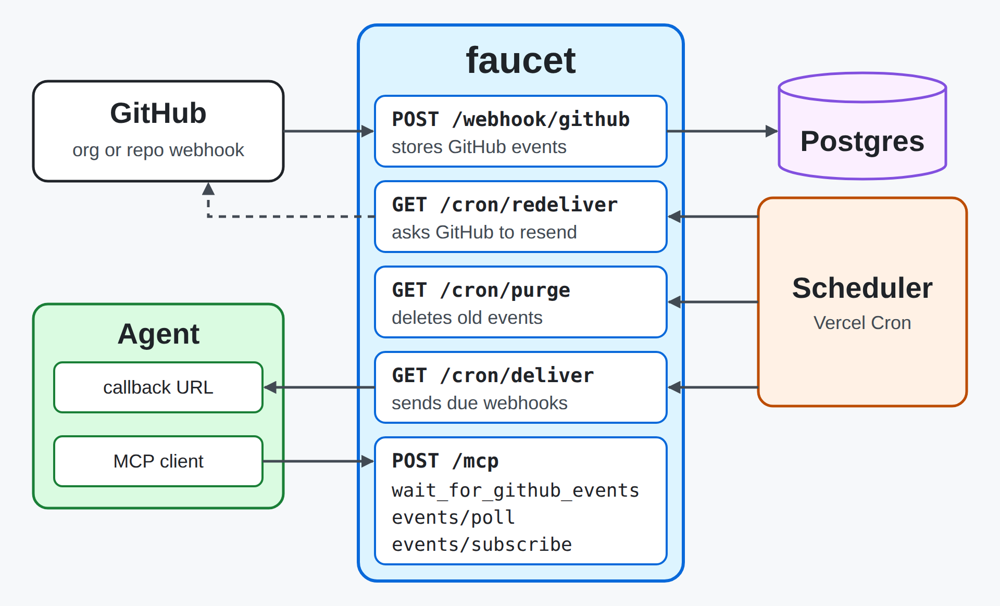
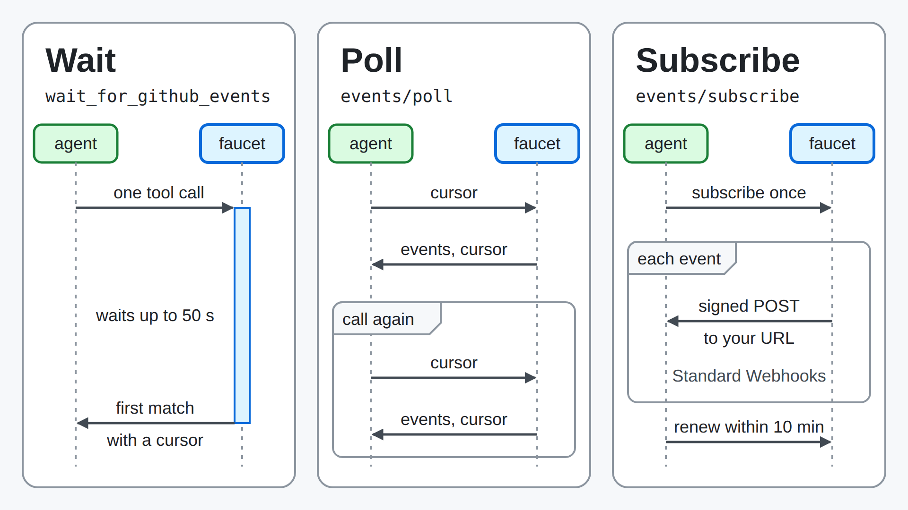

# faucet

GitHub events for AI agents, over MCP.

<picture>
  <source media="(prefers-color-scheme: dark)" srcset="docs/images/map-dark.png">
  <source media="(prefers-color-scheme: light)" srcset="docs/images/map-light.png">
  
</picture>

An agent that opened a PR usually has to keep polling GitHub to find out whether CI passed or a reviewer answered. With faucet, it asks once and waits. Faucet receives GitHub webhooks, stores them as typed events in Postgres, and hands them to agents over [MCP](https://modelcontextprotocol.io).

Faucet is a Go library first, with a thin HTTP server on top, so [coder/coder](https://github.com/coder/coder) can embed it in `coderd`.

## What an agent gets

<picture>
  <source media="(prefers-color-scheme: dark)" srcset="docs/images/ways-dark.png">
  <source media="(prefers-color-scheme: light)" srcset="docs/images/ways-light.png">
  
</picture>

- **Wait.** The `wait_for_github_events` tool long-polls (up to 50 seconds) and returns as soon as a matching event exists. Pass back the returned `cursor` to continue with no gaps or repeats.
- **Poll.** `events/list` and `events/poll` from the draft MCP Events extension (SEP-3415).
- **Subscribe.** `events/subscribe` registers a callback URL. Faucet sends each matching event to it as a signed [Standard Webhooks](https://www.standardwebhooks.com) request. See [docs/webhooks.md](docs/webhooks.md).

An agent asks for events by name, of one `repo` (a service also of an `owner` or of `all` repositories), optionally narrowed by `sha`, `pr`, GitHub's `actions` and field filters such as `head_branch` or `conclusion`. A name is a family or one of its exact types (see [docs/events.md](docs/events.md)):

<!-- BEGIN generated:events -->
| Family | GitHub event | Exact types |
| --- | --- | --- |
| `ci.runs` | `workflow_run` | `ci.run_completed` |
| `ci.jobs` | `workflow_job` | none |
| `ci.checks` | `check_run` | `ci.check_completed` |
| `ci.suites` | `check_suite` | none |
| `ci.statuses` | `status` | none |
| `pr.activity` | `pull_request` | `pr.closed` |
| `pr.reviews` | `pull_request_review` | `pr.review_submitted` |
| `pr.comments` | `issue_comment` | `pr.comment_created` |
| `pr.review_comments` | `pull_request_review_comment` | none |
| `pr.review_threads` | `pull_request_review_thread` | none |
<!-- END generated:events -->

The operator can also offer other GitHub events of a repository, such as `push`, `release` and `issues`, raw as `github.<event>`, by listing them in `FAUCET_RAW_EVENTS`. Faucet stores one only while a subscription or a poller wants it, and never a draft release (see [raw events](docs/events.md#raw-events)).

A caller of `/github/mcp` proves who it is in one of three ways, each of which gets it a token that faucet mints, and faucet returns events only for repositories that the caller may read (see [docs/security.md](docs/security.md)):

- **A browser login.** A coding agent connects with no token, and its user logs in to GitHub through faucet in a browser. Faucet keeps the user's GitHub App token, sealed, and gives the agent only faucet's own tokens (see [docs/browser-login.md](docs/browser-login.md)).
- **A client ID and secret** that an operator made for a service agent, which holds no GitHub token (see [docs/service-accounts.md](docs/service-accounts.md)).
- **A workload's own token.** A Vercel function or a Kubernetes pod trades the token that its platform signs for it for a token of a service client, with no stored secret (see [docs/service-accounts.md](docs/service-accounts.md#log-in-with-a-workload-identity)).

Faucet takes no GitHub token as a bearer token. It answers one as it answers a request with no token, with a 401 whose challenge leads the client to faucet's login server, and never sends it to GitHub (see [docs/upgrading.md](docs/upgrading.md#github-tokens-are-refused)).

The one GitHub token that faucet holds for itself, for redelivery, is optional.

Faucet also deletes events after a retention period, and it can ask GitHub to [redeliver webhooks that failed](docs/redelivery.md) while it was down.

## Quick start

You need Go and Postgres 13 or newer.

```sh
DATABASE_URL='postgres://postgres@127.0.0.1:5432/postgres?sslmode=disable' \
GITHUB_WEBHOOK_SECRET="$(openssl rand -hex 32)" \
FAUCET_PUBLIC_URL='http://localhost:8080' \
go run ./cmd/faucet
```

The server listens on `PORT` (default 8080) and applies migrations at startup. `FAUCET_PUBLIC_URL` is the URL that clients call, where faucet's login server lives. Set it to your host's URL, such as `https://faucet.example.com`, once clients call faucet from elsewhere. Then add a webhook to your GitHub org or repository:

- **Payload URL:** `https://<your host>/webhook/github`
- **Content type:** `application/json`
- **Secret:** the value of `GITHUB_WEBHOOK_SECRET`
- **Events:** "Let me select individual events", then Pull requests, Pull request reviews, Pull request review comments, Pull request review threads, Issue comments, Workflow runs, Workflow jobs, Check runs, Check suites and Statuses (see [docs/events.md](docs/events.md#the-github-webhook))

Point an MCP client at `https://<your host>/github/mcp`. A coding agent connects with no token and logs its user in through a browser once the [browser login](docs/browser-login.md) is on. A service agent logs in as a client that an operator made (see [docs/service-accounts.md](docs/service-accounts.md)). `/mcp` serves the same endpoint as an alias for one release (see [docs/upgrading.md](docs/upgrading.md#to-githubmcp)).

## Configuration

<!-- BEGIN generated:settings -->
| Variable | Required | Purpose |
| --- | --- | --- |
| `DATABASE_URL` | yes | Postgres connection for requests. A transaction-mode pooler works. |
| `DATABASE_URL_UNPOOLED` | no | Direct connection for migrations, when `DATABASE_URL` is a pooler. |
| `GITHUB_WEBHOOK_SECRET` | yes | The GitHub webhook's secret, at least 16 bytes. |
| `PORT` | no | Listen port. Default 8080. |
| `FAUCET_GITHUB_API_URL` | no | GitHub API base URL. Default `https://api.github.com`. |
| `CRON_SECRET` | for cron routes | Bearer token for `/cron/*`: 16 to 1024 printable ASCII characters, no spaces. Unset turns the cron routes off. |
| `FAUCET_RETENTION_DAYS` | no | How many days events are kept, from 1 to 3650. Default 30. |
| `FAUCET_WEBHOOK_KEY` | for webhooks | 32 random bytes, base64. Seals subscriber secrets at rest. |
| `FAUCET_WEBHOOK_CALLBACK_VERIFICATION` | no | How webhook mode checks callback URLs: `allowlist` (default) or `handshake`. |
| `FAUCET_WEBHOOK_ALLOWED_ORIGINS` | in `allowlist` mode | Comma-separated `https://host[:port]` origins that may receive webhooks. Must be unset in `handshake` mode. |
| `FAUCET_HOOK_TOKEN` | for redelivery | GitHub token that lists and redelivers the hook's deliveries. |
| `FAUCET_HOOK_ID` | for redelivery | Numeric ID of the GitHub webhook to watch for failed deliveries. |
| `FAUCET_HOOK_ORG` | for an org hook | The organization that owns the hook. Set this or `FAUCET_HOOK_REPO`, not both. |
| `FAUCET_HOOK_REPO` | for a repo hook | The repository that owns the hook, as `owner/name`. |
| `FAUCET_PUBLIC_URL` | yes | Faucet's public URL, such as `https://faucet.example.com`, or `http` on a loopback host such as `http://localhost:8080`, with no path or trailing slash. Faucet's login server lives there, and every caller logs in there: service clients (see [docs/service-accounts.md](docs/service-accounts.md)) and the browser login. The server refuses to start without it, except on Vercel production, where an unset one is `https://` and `VERCEL_PROJECT_PRODUCTION_URL`. Set it there anyway to pin it: a shorter custom domain added later changes that URL, which ends every browser session and access token (see [docs/deploy.md](docs/deploy.md#the-public-url)). |
| `FAUCET_GITHUB_APP_CLIENT_ID` | for the browser login | The client ID of faucet's GitHub App. With the secret and the token key it turns on the browser login of coding agents (see [docs/browser-login.md](docs/browser-login.md)). |
| `FAUCET_GITHUB_APP_CLIENT_SECRET` | for the browser login | A client secret of faucet's GitHub App. |
| `FAUCET_TOKEN_KEY` | for the browser login | The keys that seal the GitHub tokens of users at rest: one or more `<key_id>:<32 random bytes, base64>`, comma-separated. The first seals, every one opens (see [rotating the key](docs/browser-login.md#rotate-the-token-key)). |
| `FAUCET_GITHUB_URL` | no | GitHub's web host, which serves the App's login page. Default `https://github.com`. |
| `FAUCET_RAW_EVENTS` | for raw events | Comma-separated GitHub events, such as `push,release,issues`, that faucet offers raw as `github.<event>` (see [docs/events.md](docs/events.md#raw-events)). Unset offers none. The server refuses to start on an event whose payload GitHub shows only to people with more than read access. |
| `VERCEL` | set by Vercel | Marks a Vercel deployment. There the server never migrates without `VERCEL_ENV`. |
| `VERCEL_ENV` | set by Vercel | When set, the server migrates only if it is `production`, and otherwise starts only on a current schema. |
| `VERCEL_PROJECT_PRODUCTION_URL` | set by Vercel | The host of the project's production deployment: its shortest custom domain, or its `vercel.app` domain. Vercel sets it in every environment, and only in production does faucet take it for an unset `FAUCET_PUBLIC_URL`. |
<!-- END generated:settings -->

The server refuses to start on an invalid or incomplete feature configuration, and it names the variable but never the value. A feature whose variables are unset stays off, and its routes answer 503.

## Scheduled routes

Faucet sends nothing on its own between requests. A scheduler calls these with `Authorization: Bearer <CRON_SECRET>`:

| Route | Suggested schedule | What it does |
| --- | --- | --- |
| `GET /cron/deliver` | every minute | Sends due webhooks to subscribers and retries failed ones. |
| `GET /cron/redeliver` | every 10 minutes | Asks GitHub to resend webhooks that faucet failed to store. |
| `GET /cron/purge` | hourly | Deletes events past retention, expired subscriptions and leases, the raw payloads that nobody waits for, and the login server's expired tokens, login requests and dead sessions. |

[`vercel.json`](vercel.json) sets these schedules for Vercel Cron.

## Deploy

Faucet runs anywhere that runs a Go binary next to Postgres. This repository deploys to Vercel with Neon Postgres. [docs/deploy.md](docs/deploy.md) has the setup, plus the runbooks for credential rotation, rollbacks and database restores.

## Embed it

The packages:

- [`faucet`](faucet): the core. `faucet.New` builds a `Service`. Mount `Service.WebhookHandler()` on your router. Build your `*mcp.Server` with `mcp.ServerOptions{Capabilities: faucet.ServerCapabilities()}`, call `Service.Register` on it, and wrap its HTTP handler in `faucet.RequireEventName`, which checks the `Mcp-Name` header and refuses JSON-RPC batches. Bring your own `Authorizer` and principal lookup, or use `TokenAuthorizer`, which asks GitHub with a principal's own GitHub token, as faucet's browser login does (see [docs/security.md](docs/security.md#principals-and-scopes) for the principal kinds and the scopes).
- [`faucet/redelivery`](faucet/redelivery): the failed-webhook sweep, built with `redelivery.New`.
- [`faucet/pgstore`](faucet/pgstore): the Postgres store, with embedded migrations.
- [`faucet/storetest`](faucet/storetest): the contract tests that every `Store` must pass.
- [`faucet/oauth`](faucet/oauth): faucet's login server, with the token endpoint and its metadata, the clients of services and their grants, the browser login of users, and the tokens that it mints.

[`cmd/faucet`](cmd/faucet) is the reference host and wires all of it together. The host decides who may call `Service.Purge`, `Service.DeliverDue` and `Runner.Run`, and when.

## Docs

- [docs/events.md](docs/events.md): the event names, their actions and filters, and the GitHub webhook to set up.
- [docs/webhooks.md](docs/webhooks.md): the contract for a callback receiver (signatures, retries, cursors, control messages, secret rotation).
- [docs/redelivery.md](docs/redelivery.md): how failed GitHub deliveries are recovered, with the sweep's guarantees, capacity and known limits.
- [docs/security.md](docs/security.md): the three kinds of caller, the access checks, what protects the browser login and workload logins, the callback URL guard and secret handling.
- [docs/deploy.md](docs/deploy.md): deploying and operating faucet, and what each scheduled route answers.
- [docs/service-accounts.md](docs/service-accounts.md): service agents that log in with client credentials or with their platform's token, how an operator makes their clients and trust rules, and how grants match repositories.
- [docs/browser-login.md](docs/browser-login.md): the browser login of coding agents, the GitHub App that an operator makes for it, what faucet keeps, and how to rotate `FAUCET_TOKEN_KEY`.
- [docs/upgrading.md](docs/upgrading.md): what to change on the GitHub hook and during a rolling deploy when you upgrade.

## Development

```sh
FAUCET_TEST_DATABASE_URL='postgres://postgres@127.0.0.1:5432/postgres?sslmode=disable' go test -race ./...
```

Each test creates and drops its own database. After you change a migration or a query, run `go -C tools tool sqlc generate -f ../sqlc.yaml`. The end-to-end checks live in [`verify/`](verify). [AGENTS.md](AGENTS.md) has the rules for working on the code.

## License

[MIT](LICENSE)
