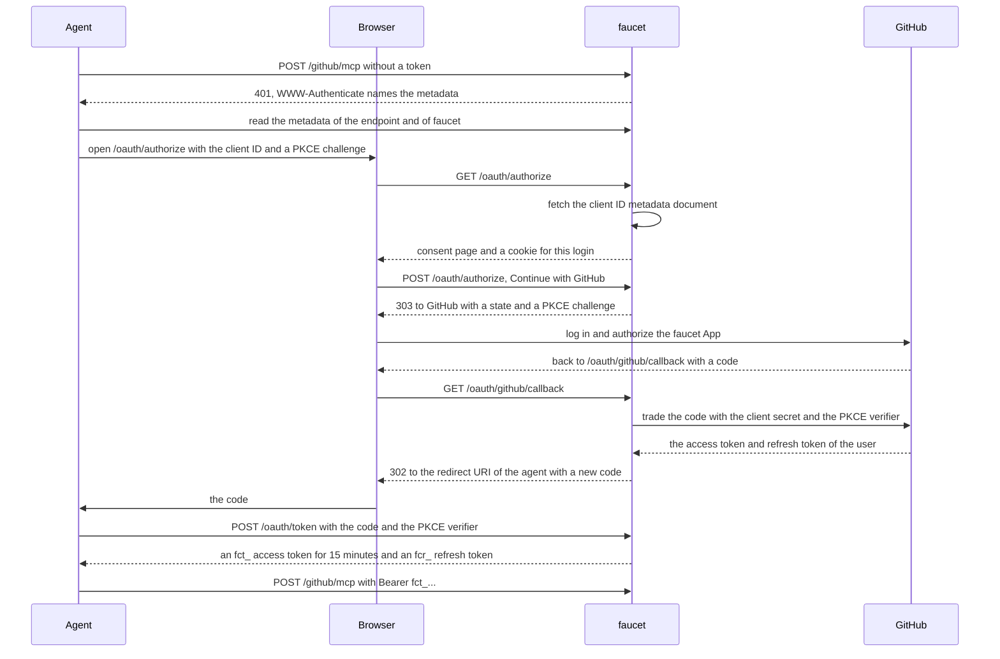

# Browser login

A coding agent can connect to `https://<your host>/github/mcp` with no token. Faucet answers 401, the agent opens a browser, and its user logs in to GitHub through faucet. Nobody makes a GitHub token by hand.

For this way in, faucet keeps the user's GitHub App token. It seals the token under `FAUCET_TOKEN_KEY` and gives the agent only faucet's own tokens, an access token for 15 minutes and a refresh token. The [security model](security.md#three-kinds-of-caller) compares this with a service and a workload. It is the only way in for a person: faucet refuses a GitHub token that a caller sends as its bearer token (see [upgrading.md](upgrading.md#github-tokens-are-refused)).

## Turn it on

1. Make a GitHub App for faucet, under the organization's **Settings**, **Developer settings**, **GitHub Apps**:
   - **Callback URL:** the value of `FAUCET_PUBLIC_URL` followed by `/oauth/github/callback`.
   - **Expire user authorization tokens:** on. Faucet keeps no token that never expires. With this off, every login stops at a page that says "faucet cannot keep this login", and the log names the setting.
   - **Repository permissions:** read-only. Metadata is enough, because faucet asks GitHub only whether the user can read a repository.
   - **Webhook:** off. Events still come from the hook of the [quick start](../README.md#quick-start). Faucet uses no installation token and no private key of the App.
2. Make a client secret for the App.
3. Install the App on each organization or repository that users want events from. A GitHub App user token reaches only the repositories where the App is installed and that the user can read. A user gets no events from a repository without the App.
4. Set the settings:

   ```sh
   FAUCET_PUBLIC_URL='https://faucet.example.com'
   FAUCET_GITHUB_APP_CLIENT_ID='<the client ID of the App>'
   FAUCET_GITHUB_APP_CLIENT_SECRET='<the client secret>'
   FAUCET_TOKEN_KEY="k1:$(openssl rand -base64 32)"
   ```

   When one of the last three is set without the others, the server refuses to start and names the missing variables. It refuses to start without `FAUCET_PUBLIC_URL` too. On Vercel, set them for Production only, and the client secret and the key as sensitive. Keep a copy of `FAUCET_TOKEN_KEY` outside Vercel. Vercel does not show a sensitive value again, and a [rotation](#rotate-the-token-key) needs the old key.

5. Rate limit `POST /oauth/authorize` per IP at the edge, such as with the Vercel Firewall rule in [deploy.md](deploy.md#firewall). Faucet stores a row for each consent that a script posts, and relies on that limit to bound them.

## What the user sees



1. The agent calls `/github/mcp` without a token. The 401 points to the endpoint's metadata, which names faucet as the authorization server. Faucet's own metadata says that it takes client ID metadata documents.
2. The agent opens the consent page in the browser. The page shows the host of the agent's client ID in large text. Below it are the name that the agent gives, marked as unchecked, the endpoint, what each scope allows, and where the browser returns to. The page works for 10 minutes.
3. The user presses **Continue with GitHub**. It works only once the page has been visible and in focus for 500 milliseconds, so that a click meant for another page cannot press it. A press that began before then does not count. GitHub asks them to log in and, the first time, to authorize faucet's App.
4. GitHub sends the browser back to faucet, and faucet sends it on to the agent with a code. The agent must trade the code for faucet's tokens within 60 seconds. From then on it refreshes them without the browser.

When a step fails, the browser shows a page that says what happened and tells the user to start again from the agent. When the user refuses at GitHub, the agent gets `access_denied`.

An agent names itself with a Client ID Metadata Document. That is a JSON document with the agent's name and redirect URIs, served at an `https` URL, and the URL is the agent's client ID. Faucet takes no dynamic client registration, so a client that can only register itself cannot log in. The consent page shows the host of the URL, because the name in the document is the client's own claim. When faucet refuses a document or a request, the page gives the reason for the client's developer. Faucet keeps a document that passed its checks for as long as its `Cache-Control` or `Expires` header lets a shared cache keep it, and 5 minutes at most, so a change to a document shows within 5 minutes. It keeps the failure of a fetch for 1 minute, and refuses a client ID on its own host without fetching it. The consent page stores nothing: its form carries the request, sealed under `FAUCET_TOKEN_KEY` for the cookie of the browser that got the page, and faucet stores the request only when the user presses Continue. go-sdk's `auth.NewAuthorizationCodeHandler` with a `ClientIDMetadataDocumentConfig` does the agent's part, and the tests of `cmd/faucet` run it.

## What faucet keeps

| What | In what form | For how long |
| --- | --- | --- |
| The GitHub App access token and refresh token of each user | Sealed with AES-256-GCM under `FAUCET_TOKEN_KEY`. One pair per GitHub user, which all the user's sessions share. | Until a refresh or the user's next login replaces the pair. Once no session and no login request names the pair, `/cron/purge` deletes it a day after its last update. |
| One session for each login of an agent | The SHA-256 of each refresh token that the session gave out. | Until the session ends or goes unused for 180 days. `/cron/purge` then deletes it with its refresh tokens. |
| One request for each login whose user pressed Continue | The SHA-256 of the browser's cookie, of the state sent to GitHub and of the code. | 10 minutes to finish in the browser, then 60 seconds to redeem the code. `/cron/purge` deletes the request once it expired, or a day after for a request with a code, so that a code used again still ends its session. |
| Each faucet access token | Its SHA-256. | 15 minutes. `/cron/purge` deletes it after that. |
| The repositories that each user's GitHub token could read | The name and ID of each repository that passed a check, when faucet last asked GitHub and when a session last used the answer. A denial is kept as the name and the time of the check, with no ID. | A pass until a check or a refresh finds the repository denied, or a day after a session last used it, when `/cron/purge` deletes it. A denial for 15 minutes after its check, when `/cron/purge` deletes it. |

Of these, the GitHub tokens are the only ones that faucet can read back. GitHub App user tokens last 8 hours and their refresh tokens 6 months, and a refresh token works once. When the access token is close to its expiry, the user's next refresh or check makes faucet refresh the pair at GitHub and store the new pair.

## How faucet checks a repository

Faucet asks GitHub `GET /repos/{owner}/{name}` with the user's GitHub token, and stores each check that passes. A session takes a stored check, and asks GitHub nothing, only when faucet made the check after that session's last refresh. So the stored checks of a user serve every session of the user, but never a session that refreshed after the check. A denial takes the stored check of that repository away, also under the other names of a repository that was renamed. Of two answers about one repository, the one whose check started later stands. Faucet keeps a denial only as a marker for 15 minutes, so that an older pass that GitHub gave after the denial cannot come back. After those 15 minutes, every session that could take that pass has refreshed past it.

At each refresh, faucet asks GitHub again about the 50 repositories that the user used last, among those used in the last 15 minutes, and takes away those that GitHub denies. It spends at most 5 seconds on that, and half of what is left when the refresh request has a deadline. A repository that it leaves out or does not get to is asked about at its next use. When GitHub rejects the user's token during that check, faucet asks GitHub for no new token there, so that the refresh still answers in time, and takes away every check that it was to ask about. Each session's next check of one of them asks GitHub, which refreshes the token or, when GitHub refuses, ends every session of the user. An access token lasts 15 minutes, so an agent that keeps working refreshes at least that often, and **a repository that the user lost access to is denied within 15 minutes**, plus the clock skew between faucet's instances. A wait that started before then can run for up to 50 more seconds. `events/subscribe` always asks GitHub, so every renewal of a subscription checks access again.

## How a session ends

A session lasts as long as its agent refreshes its tokens. It ends, and the agent must log in again, in these cases:

- **A refresh token comes back 30 seconds or more after its first use.** Faucet takes that as a token with two holders. Within those 30 seconds the token trades again, because the parallel requests of one agent send one token at once. So two processes that share one refresh token, such as two agents that copy one token file, log each other out when their refreshes are further apart. Of the tokens that parallel refreshes get, the next refresh retires the ones that the agent did not keep, and a retired token that comes ends the session too.
- **A code comes back after the agent redeemed it.** The session that the code made ends.
- **The refresh token went unused for 180 days.** GitHub ends its own refresh tokens after six months, so faucet ends the session at its next refresh.
- **GitHub refuses the user's refresh token,** because it expired, was revoked, or was used already. Then every session of that user ends. The same happens when faucet stops after GitHub gave a user a new pair and before faucet stored that pair, because the stored refresh token is then spent.
- **The user logs in again, through any agent, and GitHub no longer takes the pair that the login replaces.** Before it stores the new pair, faucet asks GitHub with the stored one: `GET /user` with the access token while it lasts more than a minute, and a refresh with the refresh token after that. Unless GitHub takes it, every session of the user ends, and so does every code of the user that no agent redeemed yet, in the same database transaction that stores the new pair. A GitHub that does not answer counts as a refusal. So an agent that the user let in before revoking faucet's App at GitHub gets nothing from the user's next login. While GitHub takes the old pair, the login keeps the user's other sessions.

An agent logs out by revoking its refresh token at `POST /oauth/revoke` (RFC 7009), which the authorization server metadata names as `revocation_endpoint`. That ends the session, so its access token fails too. A revoked access token fails alone, and its session lives on. A client can revoke only the tokens that faucet issued to it. When a user revokes faucet's App at GitHub, GitHub rejects the user's tokens at the next check or the user's next login, and faucet ends every session of that user. An operator can end every session of one user at once with `UPDATE faucet_user_sessions SET ended_at = now() WHERE connection_id = 'github:<GitHub user ID>' AND ended_at IS NULL`. `/cron/purge` then deletes the ended sessions, and a day later the sealed pair.

## Rotate the token key

`FAUCET_TOKEN_KEY` holds one or more keys. The first key seals, and every key opens the tokens that it sealed.

1. Put a new `<key_id>:<key>` first and keep the old one, such as `k2:<new key>,k1:<old key>`. Make the new key with `openssl rand -base64 32`.
2. Deploy. A user's row moves to the new key when faucet refreshes the user's GitHub token or the user logs in again. For a user whose agent stays active, a refresh comes within 8 hours.
3. Drop the old key once `SELECT count(*) FROM faucet_connections WHERE key_id = 'k1'` gives 0, and wait at least 10 minutes after the deploy: a consent page that faucet showed before it carries a form sealed under the old key for that long. A row whose `refresh_expires_at` has passed is of no use anyway, because its user must log in again whatever the key.

If faucet runs without a key that rows name, because you dropped it too early or lost `FAUCET_TOKEN_KEY`, faucet cannot read those users' GitHub tokens. Their checks and refreshes fail, and no session ends. Put the key back and they work again. Without the key, each user recovers by logging in again, which seals a new pair under the first key.
