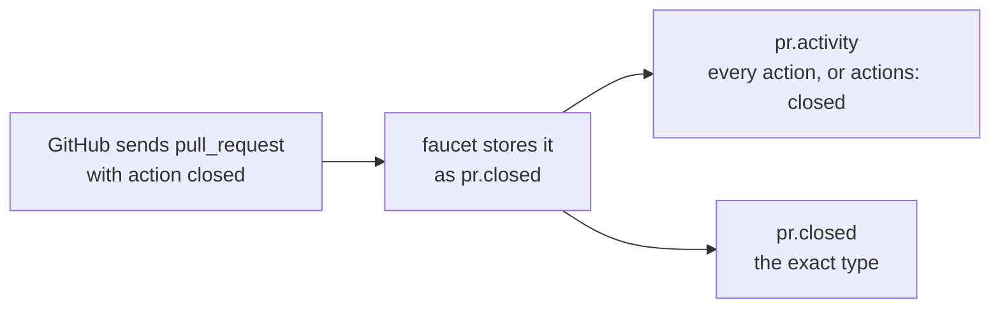

# Event names

An agent asks for events by name in `wait_for_github_events`, `events/poll` and `events/subscribe`, and `events/list` returns every name with its `inputSchema` and `payloadSchema`. A name is a **family**, which covers one GitHub webhook event, or an **exact type**, which is one action of it.

<!-- BEGIN generated:event-actions -->
| Family | Actions | Filters |
| --- | --- | --- |
<!-- END generated:event-actions -->

## Families and exact types

- A family matches every action of its GitHub event that faucet stores, and the `actions` argument narrows it to some of them. For `ci.statuses` the action is the commit status's `state`.
- An exact type matches itself and takes no `actions`. The five exact types are the names that faucet offered before families, and they work as they did. Ask for any other action by its family, narrowed with `actions`.
- The exact type of an action follows from its GitHub event: `pull_request.X` is `pr.X`, `pull_request_review.X` is `pr.review_X`, `issue_comment.X` is `pr.comment_X`, `pull_request_review_comment.X` is `pr.review_comment_X`, `pull_request_review_thread.X` is `pr.review_thread_X`, `workflow_run.X` is `ci.run_X`, `workflow_job.X` is `ci.job_X`, `check_run.X` is `ci.check_X`, `check_suite.X` is `ci.suite_X`, and a `status` whose state is X is `ci.status_X`. The `event` field of `data` and the wait tool's `type` carry it.
- `events/poll` and the webhook body name each event by the name that was polled or subscribed.
- Later versions add actions to the families. A family subscription without `actions` picks up a new action at its next renewal, and one with `actions` keeps to the actions it named.

## Field filters

A family also takes filters named after a field of its data, so an agent wakes only for what it asked. The table above lists which family offers which. Each takes a list of strings, and an event passes when its field is one of them. Different filters, and `actions`, must all match.

- "CI failed on main" is `ci.runs` with `actions: ["completed"]`, `head_branch: ["main"]` and `conclusion: ["failure", "timed_out"]`.
- "Pull requests into main to review" is `pr.activity` with `actions: ["opened", "reopened", "ready_for_review", "synchronize"]` and `base_branch: ["main"]`.
- A field that is null passes no value, so a `conclusion` filter matches no run, job or check that has not completed.
- `head_branch` never matches a branch of a fork, because a fork's `main` is not this repository's. It matches only events whose `from_fork` is false, so an event stored before `from_fork` existed matches none.
- The store applies the filters before it cuts a page, so `maxEvents`, `hasMore`, the cursor and the 100 deliveries that a subscription may hold count only the events that match. It reads the `data` of the rows that the repository and the cursor select, with no index of its own.

## What an event carries

An event carries enough to route it and to fetch the rest from GitHub, and no text: no pull request, comment or review body, no `changes`, no log, step output or commit message, and no status description. Each `payloadSchema` lists every field. `pr.comments` events carry no head SHA, because GitHub names no head commit in a comment. `ci.jobs` and `ci.statuses` events name no pull request, so their `prs` is empty and they take no `pr` argument.

## The GitHub webhook

Under "Which events would you like to trigger this webhook?", choose "Let me select individual events" and tick ten: Pull requests, Pull request reviews, Pull request review comments, Pull request review threads, Issue comments, Workflow runs, Workflow jobs, Check runs, Check suites and Statuses. **A hook that lacks an event stores none of its events, and nothing tells you so.**

Faucet stores every action of the five pull request events (comments on plain issues excepted), every action of workflow runs and workflow jobs, the `created` and `completed` actions of check runs, the `completed` action of check suites, and every commit status. Repository and organization webhooks receive no other check run or check suite action. Faucet answers every other delivery with 202 and stores nothing.

Mind the volume. Every push to a pull request's branch is a `pr.synchronize` event, and every label, review request or edit is one more. A workflow run with N jobs stores about 3N job events and 2N check events, besides its 3 run events and 1 suite event. An event's data is a few hundred bytes (167 to 384 in the samples in `faucet/testdata`), but each delivery is also an attempt in the hook's delivery list, which [redelivery](redelivery.md#capacity) reads. Leave an event off when no agent needs it.
