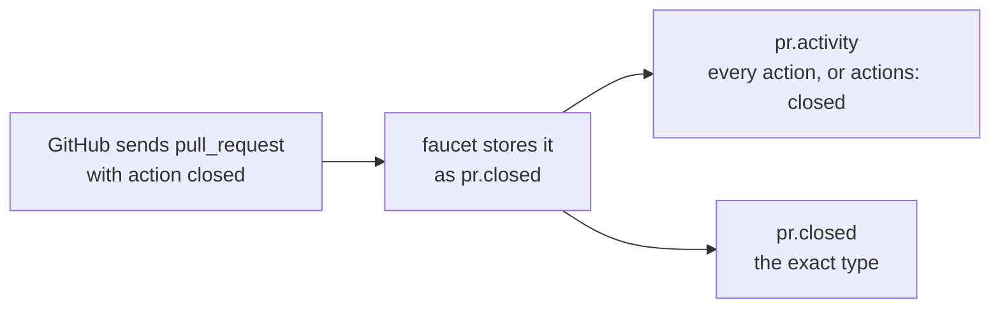

# Event names

An agent asks for events by name in `wait_for_github_events`, `events/poll` and `events/subscribe`, and `events/list` returns every name with its `inputSchema` and `payloadSchema`. A name is a **family**, which covers one GitHub webhook event, or an **exact type**, which is one action of it.

<!-- BEGIN generated:event-actions -->
| Family | Actions | Filters |
| --- | --- | --- |
| `ci.runs` | `completed`, `in_progress`, `requested` | `head_branch`, `conclusion` |
| `ci.jobs` | `completed`, `in_progress`, `queued`, `waiting` | `conclusion` |
| `ci.checks` | `completed`, `created` | `conclusion` |
| `ci.suites` | `completed` | `conclusion` |
| `ci.statuses` | `error`, `failure`, `pending`, `success` | none |
| `pr.activity` | `assigned`, `auto_merge_disabled`, `auto_merge_enabled`, `closed`, `converted_to_draft`, `demilestoned`, `dequeued`, `edited`, `enqueued`, `labeled`, `locked`, `milestoned`, `opened`, `ready_for_review`, `reopened`, `review_request_removed`, `review_requested`, `synchronize`, `unassigned`, `unlabeled`, `unlocked` | `base_branch`, `head_branch` |
| `pr.reviews` | `dismissed`, `edited`, `submitted` | none |
| `pr.comments` | `created`, `deleted`, `edited` | none |
| `pr.review_comments` | `created`, `deleted`, `edited` | none |
| `pr.review_threads` | `resolved`, `unresolved` | none |
<!-- END generated:event-actions -->

## Families and exact types

- A family matches every action of its GitHub event that faucet stores, and the `actions` argument narrows it to some of them. For `ci.statuses` the action is the commit status's `state`.
- An exact type matches itself and takes no `actions`. The five exact types are the names that faucet offered before families, and they work as they did. Ask for any other action by its family, narrowed with `actions`.
- The exact type of an action follows from its GitHub event: `pull_request.X` is `pr.X`, `pull_request_review.X` is `pr.review_X`, `issue_comment.X` is `pr.comment_X`, `pull_request_review_comment.X` is `pr.review_comment_X`, `pull_request_review_thread.X` is `pr.review_thread_X`, `workflow_run.X` is `ci.run_X`, `workflow_job.X` is `ci.job_X`, `check_run.X` is `ci.check_X`, `check_suite.X` is `ci.suite_X`, and a `status` whose state is X is `ci.status_X`. The `event` field of `data` and the wait tool's `type` carry it.
- `events/poll` and the webhook body name each event by the name that was polled or subscribed.
- Later versions add actions to the families. A family subscription without `actions` picks up a new action at its next renewal, and one with `actions` keeps to the actions it named.

## Targets

The arguments of the wait tool, `events/poll`, `events/subscribe` and `events/unsubscribe` name exactly one target, which says whose events to read:

- `repo`, written `owner/name`: one repository.
- `owner`, a GitHub login: every repository of that user or organization, also one it makes later.
- `all: true`: every repository that faucet receives deliveries from.

**`owner` and `all` are for [service clients](service-accounts.md#grants) only.** Any other caller, a user of the [browser login](browser-login.md), gets `Forbidden` (-32024) from `events/poll` and `events/subscribe`, and an error result from the wait tool, which tells it to name one repository with `repo`. A service needs a grant that covers the target.

With `owner` or `all`, `repos` (a list of `owner/name`) keeps the events of those repositories only. It matches the full name that each delivery carried, ignoring case, and with `owner` each entry must be a repository of that owner.

An `owner` target reads only the typed events stored since faucet added owner targets, because an older event does not record its owner. An `all` target reads every event.

Through an `owner` or `all` target, the `data` of a typed event also holds `repo_id` and `repo`, the full name that its delivery carried (an event stored before faucet recorded names has `repo_id` only). A `repo` target's data is as before. The data of a raw event is GitHub's payload, whose `repository` already names it.

## Cursors

A cursor is a place among the events of the target that the call names, written `v2.<n>`. Faucet numbers the events of each repository 1, 2, 3 in the order it stores them, and the events of each owner across its repositories; the events of `all` count every event. So a cursor, and every other number or flag that a reader gets (`hasMore`, `truncated`, a webhook's `cursor`, the `id` of a waited event), counts the events of its own target and says nothing about other repositories' events or about when they arrived. The `r1.` cursors of [raw events](#raw-events) are the exception: they number every repository's raw events together.

- Faucet reads a cursor on the target that the call names, so pass it back with the same target. A cursor of another target, or one made by hand, is still only a place among this target's events.
- A cursor above the target's newest event reads as the newest, so the next event is not skipped.
- `truncated` is true when a retention purge deleted events of the target after the cursor.
- The wait tool takes and returns the same string, and each event's `id` is its place among the target's events.
- A `v1.<n>` cursor, which builds before [#78](https://github.com/coder/faucet/pull/78) returned, counts the events of every repository, so faucet never reads it as a place. `events/poll`, the wait tool and `events/subscribe` answer it with `truncated: true` and start at the newest event.

## The Mcp-Name header

Every `events/poll`, `events/subscribe` and `events/unsubscribe` request over HTTP must carry the header `Mcp-Name` with the event name of its `params.name`, or faucet answers 400 with `HeaderMismatch`. The go-sdk client does not set it for `events/*` yet. A host that embeds faucet gets the check from `faucet.RequireEventName`.

## Field filters

A family also takes filters named after a field of its data, so an agent wakes only for what it asked. The table above lists which family offers which. Each takes a list of strings, and an event passes when its field is one of them. Different filters, and `actions`, must all match.

- "CI failed on main" is `ci.runs` with `actions: ["completed"]`, `head_branch: ["main"]` and `conclusion: ["failure", "timed_out"]`.
- "Pull requests into main to review" is `pr.activity` with `actions: ["opened", "reopened", "ready_for_review", "synchronize"]` and `base_branch: ["main"]`.
- A field that is null passes no value, so a `conclusion` filter matches no run, job or check that has not completed.
- `head_branch` never matches a branch of a fork, because a fork's `main` is not this repository's. It matches only events whose `from_fork` is false, so an event stored before `from_fork` existed matches none.
- The store applies the filters before it cuts a page, so `maxEvents`, `hasMore`, the cursor and the 100 deliveries that a subscription may hold count only the events that match. It reads the `data` of the rows that the target and the cursor select, with no index of its own, and one read looks at no more than 50000 events of the target. A poll that stopped there before the newest event says `hasMore`, also when it found nothing, and its cursor goes on from there. A wait reads on through the windows without sleeping.

## What an event carries

A typed event carries enough to route it and to fetch the rest from GitHub, and no free text: no pull request, comment or review body, no `changes`, no log, step output or commit message, and no status description. A `pr.activity` event does carry short names: the title, the branches, a label or a milestone. Each `payloadSchema` lists every field. `pr.comments` events carry no head SHA, because GitHub names no head commit in a comment. `ci.jobs` and `ci.statuses` events name no pull request, so their `prs` is empty and they take no `pr` argument.

## Raw events

Faucet can offer the other GitHub events of a repository, such as `push`, `release` and `issues`, under the name `github.<event>`. It offers only the events that the operator lists in `FAUCET_RAW_EVENTS`, and none while that is unset. `events/list` returns the offered names after the typed ones. The `data` of a raw event is GitHub's payload, so it can hold free text, which a typed event never does.

<!-- BEGIN generated:raw-events -->
| `FAUCET_RAW_EVENTS` | GitHub events |
| --- | --- |
| may list | `commit_comment`, `create`, `custom_property_values`, `delete`, `deployment`, `deployment_protection_rule`, `deployment_review`, `deployment_status`, `discussion`, `discussion_comment`, `fork`, `gollum`, `issue_comment`, `issue_dependencies`, `issue_relates_to`, `issues`, `label`, `merge_group`, `milestone`, `package`, `page_build`, `project`, `project_card`, `project_column`, `public`, `push`, `registry_package`, `release`, `repository`, `repository_import`, `star`, `sub_issues`, `watch`, `workflow_dispatch` |
| refuses | `branch_protection_configuration`, `branch_protection_rule`, `code_scanning_alert`, `dependabot_alert`, `deploy_key`, `member`, `repository_advisory`, `repository_dispatch`, `repository_ruleset`, `repository_vulnerability_alert`, `secret_scanning_alert`, `secret_scanning_alert_location`, `secret_scanning_scan`, `security_and_analysis`, `team_add` |
<!-- END generated:raw-events -->

**Faucet refuses the events whose payload GitHub shows only to people with more than read access**, such as private vulnerability reports, secret scanning and Dependabot alerts, deploy keys, collaborators, the teams with access, the actors that may bypass a ruleset, and the `client_payload` that the sender of a repository dispatch sets. Faucet checks only that a caller can read the repository, and anyone can read a public one, so the server does not start when `FAUCET_RAW_EVENTS` names one of them. An event that the operator removes from the list is not stored from the next deploy on: its subscriptions get nothing more, and its leases end.

**Faucet never stores a draft release.** GitHub shows a draft release only to people with push access, so faucet answers 202 and stores nothing for a `release` delivery whose `release.draft` is not `false`, whatever its action. A draft that is created, edited or deleted reaches no lease and no subscription, with `fields` or without. When the draft is published, GitHub's `published` delivery says `draft: false`, and faucet serves it and every later delivery while the release stays published.

**Faucet stores a raw event only while someone wants it.** When a delivery arrives, faucet looks for a live subscription to its name and for a poller of it. With neither, it answers 202 and stores nothing, so nobody can read an event from before they first asked.

- A raw name takes a [target](#targets), and optionally `actions` and `fields`. `actions` matches the payload's top-level `action`. `fields` names the members to return, by path: `["ref", "commits.id"]` returns the `ref` and the `id` of each commit. When everyone who wants an event names `fields`, faucet stores only those members.
- The first `events/poll` of a raw name returns no events and starts a lease, which ends 60 minutes after its last poll. The cursor names the lease, so each poller reads every event, also when two pollers share a login. A poll with a cursor that names no live lease of that login, name, arguments and target starts a new lease and answers `truncated: true`. A login can hold 100 leases, and one more ends the one polled longest ago.
- One event of one target has at most 100 live subscriptions and leases, and one login at most 10 leases and 10 subscriptions of it, so that no login can take them all. One more lease of a login ends its lease of that event and target polled longest ago. Past either limit, `events/poll` and `events/subscribe` answer -32025 with `data.limit` `raw_interests` or `raw_subscriptions`, and a renewal always passes.
- `/cron/purge` drops a payload once no subscription still has to send it and every poller has passed it, and any payload older than 60 minutes. Faucet keeps the delivery ID for the retention, so a delivery that GitHub sends again is not stored twice.
- A delivery of an organization that names no repository, as GitHub sends some `github.project`, `github.project_card`, `github.project_column`, `github.package` or `github.registry_package` events, reaches an `owner` target of the organization and an `all` target, unless they name `repos`, and never a `repo` target.
- `github.issue_comment` carries the comments on plain issues. A comment on a pull request is a `pr.comments` event.
- `wait_for_github_events` takes no raw name.

A poller or a subscriber learns when it missed an event:

| What happened | How faucet says so |
| --- | --- |
| The lease ended | `truncated: true` on the next poll, which starts a new lease |
| A lease holds at most 1000 unread events, and one more arrived | `truncated: true` on the poll that passes it |
| A poller left an event unread for over 60 minutes, and a purge dropped its payload | `truncated: true` on the poll that passes it |
| A delivery waited for over 60 minutes, as while `/cron/deliver` was down, and a purge dropped its payload | a `gap` [control message](webhooks.md#control-messages) |
| The payload, or the `fields` of it, is over 256 KiB | `truncated: true` for a poller, a `gap` [control message](webhooks.md#control-messages) for a subscription |
| The payload, or the `fields` of it, fits in 256 KiB, and the webhook body that carries it does not | a `gap` [control message](webhooks.md#control-messages) |
| A delivery found a stored event that it could not read for the subscription, such as a payload stored as `fields` for a subscription that wants it whole, or a payload that is not JSON | a `gap` [control message](webhooks.md#control-messages) |
| A raw subscription holds 100 unsent deliveries, and one more arrived | a `gap` [control message](webhooks.md#control-messages) |

## The GitHub webhook

Under "Which events would you like to trigger this webhook?", choose "Let me select individual events" and tick ten: Pull requests, Pull request reviews, Pull request review comments, Pull request review threads, Issue comments, Workflow runs, Workflow jobs, Check runs, Check suites and Statuses. **A hook that lacks an event stores none of its events, and nothing tells you so.**

Faucet stores every action of the five pull request events (comments on plain issues excepted), every action of workflow runs and workflow jobs, the `created` and `completed` actions of check runs, the `completed` action of check suites, and every commit status. Repository and organization webhooks receive no other check run or check suite action. Faucet answers every other delivery with 202 and stores nothing, unless someone wants it as a [raw event](#raw-events). To offer an event raw, tick it on the hook too.

Mind the volume. Every push to a pull request's branch is a `pr.synchronize` event, and every label, review request or edit is one more. A workflow run with N jobs stores about 3N job events and 2N check events, besides its 3 run events and 1 suite event. An event's data is a few hundred bytes, but each delivery is also an attempt in the hook's delivery list, which [redelivery](redelivery.md#capacity) reads. Leave an event off when no agent needs it.
