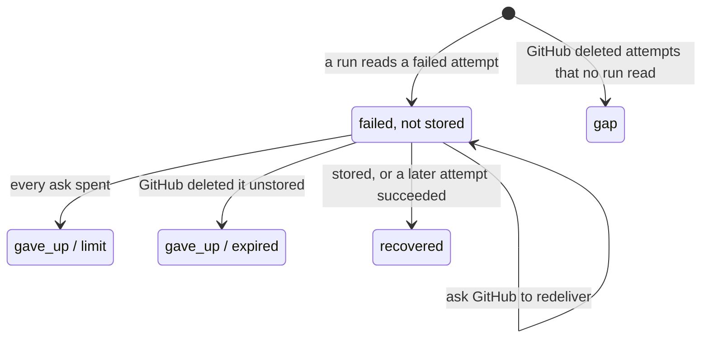

# Redelivery of failed webhooks

GitHub doesn't resend a webhook on its own when faucet was down or answered with an error. `GET /cron/redeliver` finds those failed deliveries in the hook's delivery list and asks GitHub to send each one again, until faucet stores the event.

The numbers on this page come from the constants in `faucet/redelivery`. `faucet/redelivery/docs_test.go` fails when they drift apart, so a change to a constant also needs a change here.

## Set it up

Redelivery is off, and `/cron/redeliver` answers 503, until all of these are set. If only some are set, the server refuses to start.

| Variable | Meaning |
| --- | --- |
| `FAUCET_HOOK_TOKEN` | A classic token, owned by a machine user, that can list and redeliver the hook's deliveries: `admin:org_hook` for an org hook, or the repository hook permission for a repo hook. It can also edit or delete the hook, so set it for production only. |
| `FAUCET_HOOK_ORG` or `FAUCET_HOOK_REPO` | The hook's owner: an organization, or `owner/name`. Set exactly one. |
| `FAUCET_HOOK_ID` | The hook's numeric ID. |

Schedule it every 10 minutes (`*/10 * * * *`) with `Authorization: Bearer <CRON_SECRET>`. The capacity figures below assume that schedule.

## What a run does

A run reads GitHub's deliveries, newest first, down to where the previous run stopped, less a 5 minute overlap for attempts that GitHub wrote late. A stretch that it can't read within its page limit is kept as an open range, with GitHub's cursor, and later runs read the ranges, newest first.

A delivery qualifies when an attempt failed (any answer outside 200 to 299, or none), faucet stores its event and action, someone wants it as a [raw event](events.md#raw-events) when the run starts, or it renamed or transferred a repository on a host that records repositories ([service accounts](service-accounts.md#grants)), and faucet has no event with its GUID. A stored delivery, or one that later succeeded, is never asked for. Only one run works at a time: a second one answers `busy: true`.

## Final states

Every failed delivery ends exactly once, in one of these states, except in the cases that [Known limits](#known-limits) lists. The run that ends it counts it in the reply and logs it:

- **`recovered`**: faucet stored the event, or a later attempt succeeded. A raw delivery recovers only by a later attempt: faucet answers it 200 when it stores the event, and 202 when nobody wants the event any more.
- **`gave_up` / `limit`**: every ask was spent. A delivery is asked for 7 times, at 0, 10, 30, 70, 150, 310 and 630 minutes after the run that first read it. The count goes up before the request is sent, so a crash costs an ask, and two runs never send the same one.
- **`gave_up` / `expired`**: GitHub keeps a delivery for 72 hours, counted from its first attempt, and the event still wasn't stored. Deliveries of a hook that you replaced end here too, because a run only asks for the deliveries of the hook it's configured with.
- **`gap`**: a time range of attempts that no run read before GitHub deleted them. It names no delivery, because none was read. The first run that reads an attempt reports `gaps: 1` for the part of GitHub's 72 hours before its lookback of 24 hours.

An outage of faucet that ends within 630 minutes of the first run that reads a failure is recovered by one of its asks.

## Clocks and GitHub's `Date` header

Faucet's clock and GitHub's differ, so redelivery never derives a read position from faucet's clock. A run's position is the time of the newest attempt it read. An empty list leaves the position unchanged.

A run uses GitHub's `Date` header in two places:

- The `Date` of a page that ends the list says where GitHub's 72 hours end. A gap ends there, plus a slack of 1 hour for a `Date` that is behind.
- The `Date` of the last run says when a run last saw the top of the list. After a silence, a gap starts there, less a margin of 6 hours for a `Date` that is ahead, and less the 5 minute overlap.

A `Date` can lower where a read stops, never raise it. A `Date` that is missing, or more than the slack behind the newest attempt the run knows, fails that read: on the first page the run fails and asks for nothing, and on a later page the range stays open.

So a gap never reaches above the oldest attempt that a run read above it. When the `Date` is right, a gap can hold just over an hour in which GitHub deleted nothing, and when it runs the margin of 6 hours ahead, up to about 7 hours. After a silence a gap starts 6 hours and 5 minutes before the `Date` of the run before it, so a hook that delivers nothing logs a gap only when two runs are about 64 hours and 55 minutes apart, or more. A run that finds the list empty records a gap only when the last run that read the list was about 64 hours and 55 minutes before it, or more.

`faucet/redelivery/redeliver_gaps_test.go` and `redeliver_sim_test.go` cover these cases against a GitHub whose clock is up to 25 hours off, and whose `Date` leads, lags or is missing.

## Capacity

A run reads at most 20 pages of 100 attempts, which is 2,000 attempts, and sends at most 50 requests. On the 10 minute schedule a run covers 15 minutes of the list (10 new minutes plus the 5 minute overlap). It needs one attempt beyond them to see the end of that window, and it starts from the newest attempt of the run before it, so a run holds at most 1,998 attempts of its window. That is 7,992 attempts an hour at best. Rounded down for a run that starts late, the sweep keeps up with 7,900 attempts an hour, and sends at most 300 requests an hour.

Those figures assume GitHub answers each page within 0.6 seconds, because a run spends half of its 25 seconds reading the list. At 1.3 seconds a page, a run reads 9 pages and the sweep keeps up with about 3,500 attempts an hour. Faucet has no measurement of GitHub's page time, so size your hook with that margin. The list counts every attempt on the hook, including events that faucet ignores and the redeliveries that it asked for.

Above capacity nothing is lost silently: the unread part stays an open range, and a range that no run reads before GitHub deletes it is counted and logged as a gap. The simulations run 4,200 attempts an hour with one failure in 100, plus outages of up to an hour, and lose no failure.

## Time budget

The cron route stops a run after 25 seconds. A run reads the list for half of that, leaves any page that isn't back as an open range, asks until 80 percent of the time has passed, and then purges. A slow GitHub costs pages, never the asks. A first page that isn't back in time ends the run with an error, and the run asks for nothing.

## Known limits

Redelivery trusts a `Date` up to 6 hours ahead of GitHub's list (the margin) and up to 1 hour behind the clock that deletes GitHub's attempts (the slack). Changing either needs a design review. These cases can still end a failure without a final state, or only inside a counted gap:

- **`Date` far ahead, then a long outage.** When a `Date` runs more than 6 hours and 5 minutes ahead of GitHub's list and the cron then stops for 72 hours or more, failures in the stretch between the last run and the start of the next gap are never read or counted. A position that a build from before migration `000008_redelivery_clear` took from such a `Date` carries the same risk. ([#26](https://github.com/coder/faucet/issues/26))
- **`Date` far behind on a quiet hook.** When a `Date` is more than 1 hour behind the clock that deletes GitHub's attempts, and no listed attempt shows the lag, a gap can end too early, and failures above it aren't counted. On a busy hook the run sees the lag and fails instead. ([#26](https://github.com/coder/faucet/issues/26))
- **Dense burst, then silence.** When a burst holds more attempts in the 5 minute overlap than a run has pages, every run reads the same newest pages again, and older ranges starve. Their failures end inside counted gaps. ([#37](https://github.com/coder/faucet/issues/37))
- **A raw event without a repository in the list.** A run knows who wants a raw delivery by the repository that GitHub's delivery list names for it. A failed raw delivery that the list names no repository for is never asked for again or counted.
- **A run that cannot read the raw interests.** When faucet cannot read who wants raw events, or the read takes more than a tenth of the run, the run logs it and asks again for every failed delivery of an event that faucet offers raw, wanted or not. The limit of asks per run bounds them, and a delivery that nobody wants is answered 202 and recovers.
- **Replacing the hook.** Failures that the old hook listed after the last run are never read or counted, because the new hook can't read the old hook's list. ([#38](https://github.com/coder/faucet/issues/38))

## Embedding

Build a runner with `redelivery.New(redelivery.Deps{...})` and call `Runner.Run(ctx)` on your own schedule. `redelivery.NewGitHubHookAdmin` talks to GitHub's REST API. A `HookAdmin` of your own must put GitHub's `Date` header in `DeliveryPage.At`, and a `Store` of your own must pass `storetest.RunRedelivery`. Pass the same logger as `faucet.Deps`: the log is the only record that names a give-up or a gap.
