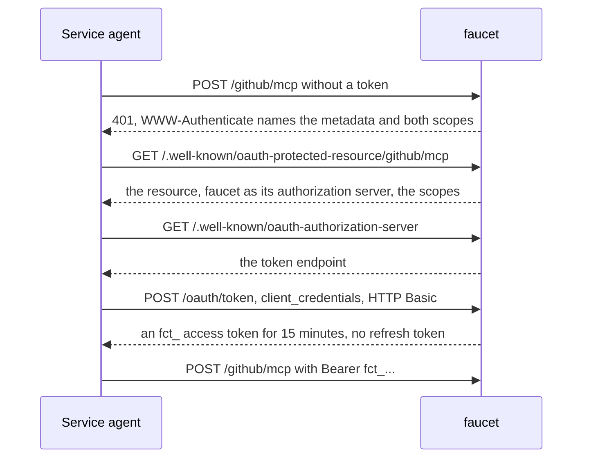

# Service accounts

A service agent, such as one that analyzes GitHub events, logs in to faucet with a client ID and secret that an operator made ahead of time. It holds no GitHub token: faucet checks its access against the repositories that the operator granted it, and never asks GitHub about them.

## Turn it on

Set `FAUCET_PUBLIC_URL` to the URL that clients call, such as `https://faucet.example.com`. A client compares the URLs that it computes from it byte for byte, so the server refuses to start unless it is `https` (`http` only on a loopback host) with a lower-case host, no default port and no path, not even a trailing slash. On Vercel, set it for Production only. Unset, none of the routes on this page exist, except on Vercel production, where faucet takes `https://` and `VERCEL_PROJECT_PRODUCTION_URL` instead (see [deploy.md](deploy.md#the-public-url)).

Tick **Repositories** in the GitHub webhook's events as well (see [Grants](#grants)).

## Make a client

```sh
DATABASE_URL='<the production database URL>' FAUCET_PUBLIC_URL='https://faucet.example.com' \
  go run ./cmd/faucet clients create -grant repo:coder/faucet ci-watcher
```

The command prints `client_id` and `client_secret` once. Faucet keeps only a hash of the secret. Each `-grant` names what the client may read (see [Grants](#grants)), and `-scope` narrows what its tokens can hold (both scopes by default). The client is for `https://<your host>/github/mcp`; pass `-resource` with that URL where `FAUCET_PUBLIC_URL` is not set. `/mcp`, the endpoint's old path, takes no new client. A client ID is never given to a second client, because the login `svc:<client-id>` owns the client's subscriptions.

`faucet clients list` shows every client without its secret. `faucet clients disable <client-id>` ends one: it gets no new token, the token it holds fails on its next request, and faucet deletes its subscriptions with the deliveries they queued. A subscription that the service made in the moment before the disable can outlive it, so run the command again if that matters. The command leaves a lease that the service holds on a [raw event](events.md#raw-events). The lease ends 60 minutes after the service's last poll. Until then, faucet stores the events that the lease asked for, and the service cannot read them. The commands never migrate, so the database must be at the newest migration.

## What the service's MCP client does

The client needs only the endpoint URL, the client ID and the secret. go-sdk's `extauth.ClientCredentialsHandler` and the TypeScript SDK's `ClientCredentialsProvider` both do the rest, and the end-to-end tests run both.



- The client sends its ID and secret in HTTP Basic authentication, each URL-encoded first as RFC 6749 section 2.3.1 says. The secret is base64url, which that encoding leaves alone, so a client that skips the step works too.
- A token request without `resource` gets the client's endpoint, because go-sdk sends none. A request for another endpoint is `invalid_target`.
- The token holds the scopes that the request asks for and the client holds, and names them in `scope`. A request for none of them is `invalid_scope`.
- There is no refresh token. When the token expires, the client asks again with its secret.
- A client that is done with a token can revoke it at `POST /oauth/revoke` (RFC 7009), with the same HTTP Basic credentials.
- A client made for another server's endpoint gets `invalid_client`, which names the endpoint, and the server logs a warning.
- The metadata names `/oauth/authorize` because the TypeScript SDK requires the field. That endpoint answers `unsupported_response_type` unless the [browser login](browser-login.md) is on.
- `/mcp` has its own metadata document and is its own resource, so a client made for one path gets no access on the other.

## Grants

A client holds one or more grants, which only `faucet clients create` sets:

| Grant | Covers | The [targets](events.md#targets) it allows |
| --- | --- | --- |
| `repo:<owner>/<name>` | that repository | `repo` of it |
| `org:<login>` | every repository of the user or organization that holds `<login>` when the client is made, also one it makes later, under any later login | `owner` of the account by its current login, and `repo` of any of its repositories |
| `all` | every repository and owner that faucet receives deliveries from | every target, `all: true` included |

`faucet clients create` binds an `org:` grant to the account that holds the login then, and the client keeps it as `org:<login>#<account ID>`, which the command prints and `faucet clients list` shows. An operator can also write `org:<login>#<account ID>`, which the command takes only when that account holds the login now. The command refuses a login that no delivery has named, because faucet cannot tell which account it is: make the client once GitHub has sent a delivery from the account or one of its repositories.

A grant covers every event that faucet offers of what it names, and that includes the [raw events](events.md#raw-events), whose data is GitHub's whole payload. Names and logins match ignoring case, as GitHub does.

Faucet asks GitHub nothing for a service, so it learns IDs from the signed deliveries, stored or ignored:

- A `repo` target is readable once GitHub has sent one delivery from the repository.
- An `owner` target is readable once GitHub has sent one delivery from the owner or any of its repositories, because faucet finds the owner's ID through them. From then on it also covers a repository of the owner that never sent a delivery before.

Until then, faucet refuses the target and says why.

`repos` narrows an `owner` or `all` target to some repositories. It matches the name that each delivery carried, not the name that faucet holds, so after a rename, list the new name.

An account's login is the one in its latest delivery, because GitHub sends no event for each repository of an account that it renames. One login names one account: once a delivery names another account by a login, the account that had it holds no login until its own next delivery. So after an organization is renamed and someone else takes its old login, a `repo:` grant of the old login reads none of the renamed organization's repositories. An `org:` grant follows its account instead: once a delivery carries the new login, the service names the owner by it, and the account that takes the old login stays out of the grant's reach.

A delivery that GitHub sends again names the accounts as they were when it first came. One that faucet's own [redelivery](redelivery.md) asked for moves no login: it only adds an account that faucet has not seen. One that a hook admin sends again by hand from GitHub gives the old login back to the renamed account, until the next delivery of either account. Until then:

- a `repo:` grant of the old login reads the renamed account's repository of that name, and not the repository of that name of the account that holds the login now;
- an `org:` grant still reads only its own account, but a service whose grant names the account that holds the login now cannot name that account by the login: its polls and waits of the `owner` target are refused, and so are the renewals of its subscriptions, which expire if the window outlasts them.

The name part of a repository is the one under which faucet first saw it until a Repositories delivery says that it was renamed or transferred from that name. So neither a replayed delivery nor a redelivered older rename can move a name back. Without that event on the hook, or when faucet missed one rename of several, a renamed repository stays under the name faucet holds: the old `repo:` grant keeps working, and a grant of the new name finds nothing. After a rename, grant the new name. An `org:` grant covers a repository by its owner's ID, so a rename inside the owner changes nothing for it.
