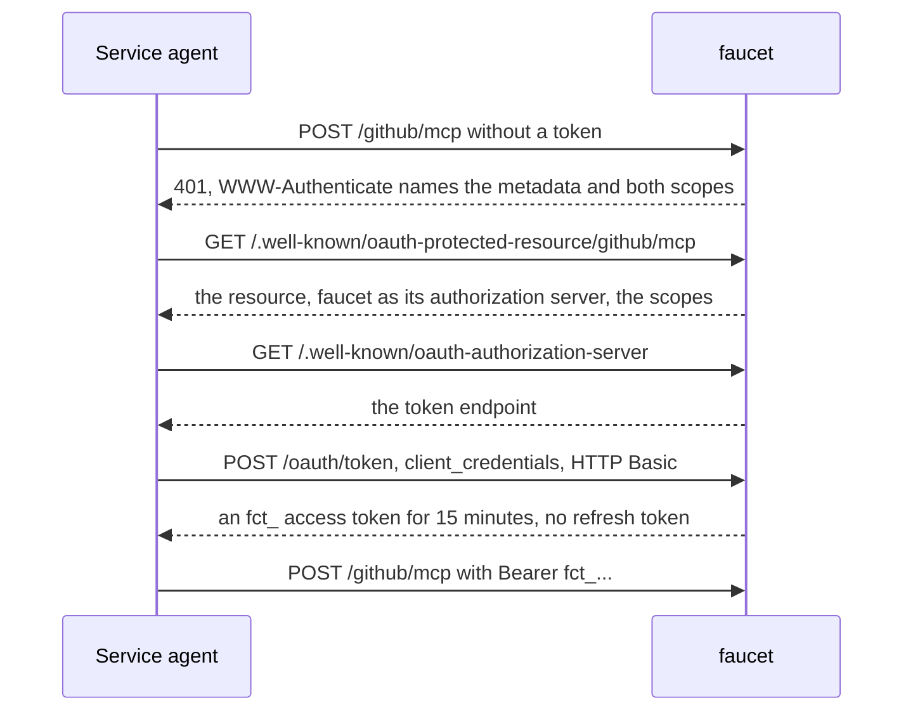

# Service accounts

A service agent, such as one that analyzes GitHub events, logs in to faucet with a client ID and secret that an operator made ahead of time. It holds no GitHub token: faucet checks its access against the repositories that the operator granted it, and never asks GitHub about them.

## Turn it on

Set `FAUCET_PUBLIC_URL` to the URL that clients call, such as `https://faucet.example.com`. A client compares the URLs that it computes from it byte for byte, so the server refuses to start unless it is `https` (`http` only on a loopback host) with a lower-case host, no default port and no path, not even a trailing slash. On Vercel, set it for Production only. Unset, none of the routes on this page exist.

Tick **Repositories** in the GitHub webhook's events as well (see [Grants](#grants)).

## Make a client

```sh
DATABASE_URL='<the production database URL>' FAUCET_PUBLIC_URL='https://faucet.example.com' \
  go run ./cmd/faucet clients create -grant repo:coder/faucet ci-watcher
```

The command prints `client_id` and `client_secret` once. Faucet keeps only a hash of the secret. Each `-grant repo:<owner>/<name>` names a repository that the client may read, and `-scope` narrows what its tokens can hold (both scopes by default). The client is for `https://<your host>/github/mcp`; pass `-resource` with that URL where `FAUCET_PUBLIC_URL` is not set. `/mcp`, the endpoint's old path, takes no new client. A client ID is never given to a second client, because the login `svc:<client-id>` owns the client's subscriptions.

`faucet clients list` shows every client without its secret. `faucet clients disable <client-id>` ends one: it gets no new token, the token it holds fails on its next request, and faucet deletes its subscriptions with the deliveries they queued. A subscription that the service made in the moment before the disable can outlive it, so run the command again if that matters. The commands never migrate, so the database must be at the newest migration.

## What the service's MCP client does

The client needs only the endpoint URL, the client ID and the secret. go-sdk's `extauth.ClientCredentialsHandler` and the TypeScript SDK's `ClientCredentialsProvider` both do the rest, and the end-to-end tests run both.



- The client sends its ID and secret in HTTP Basic authentication, each URL-encoded first as RFC 6749 section 2.3.1 says. The secret is base64url, which that encoding leaves alone, so a client that skips the step works too.
- A token request without `resource` gets the client's endpoint, because go-sdk sends none. A request for another endpoint is `invalid_target`.
- The token holds the scopes that the request asks for and the client holds, and names them in `scope`. A request for none of them is `invalid_scope`.
- There is no refresh token. When the token expires, the client asks again with its secret.
- A client that is done with a token can revoke it at `POST /oauth/revoke` (RFC 7009), with the same HTTP Basic credentials.
- A client made for another server's endpoint gets `invalid_client`, which names the endpoint, and the server logs a warning.
- The metadata names `/oauth/authorize` because the TypeScript SDK requires the field. That endpoint answers `unsupported_response_type` unless the [browser login](browser-login.md) is on.
- `/mcp` has its own metadata document and is its own resource, so a client made for one path gets no access on the other.

## Grants

A service may read a repository that one of its grants names, matched by name and ignoring case, as GitHub does. Faucet learns a repository's ID from the signed deliveries that name it, stored or ignored, so a granted repository is readable once GitHub has sent one delivery from it. Until then, the wait tool says so.

A repository keeps the name under which faucet first saw it until a Repositories delivery says that it was renamed or transferred from that name. So neither a replayed delivery nor a redelivered older rename can move a name back. Without that event on the hook, or when faucet missed one rename of several, a renamed repository stays under the name faucet holds: the old grant keeps working, and a grant of the new name finds nothing. After a rename, grant the new name.

Grants of a whole organization, or of every repository, come in a later release.
