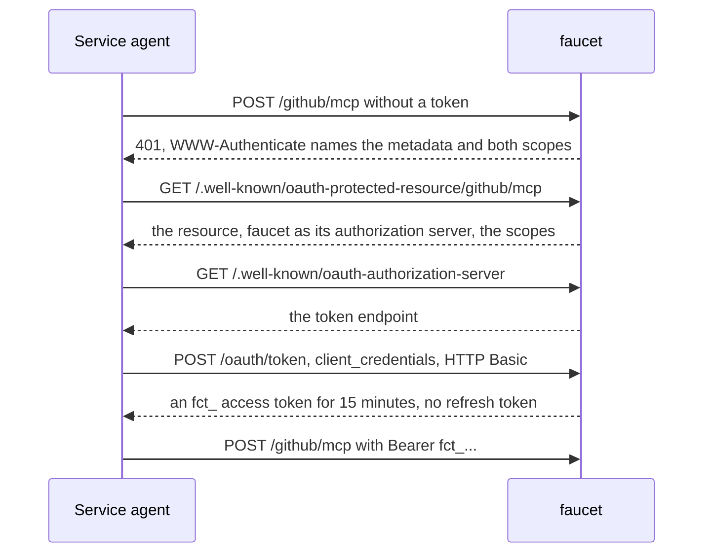
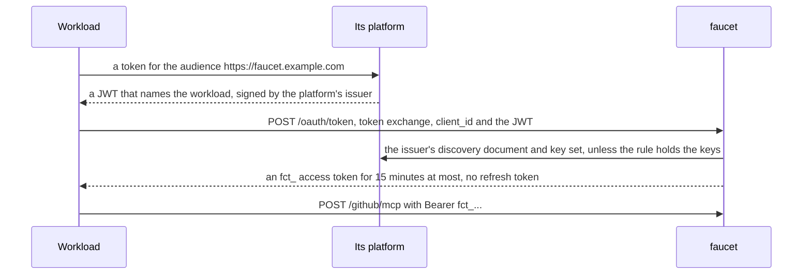

# Service accounts

A service agent, such as one that analyzes GitHub events, logs in to faucet with a client ID and secret that an operator made ahead of time, or, when it runs as a Vercel function or a Kubernetes pod, with the token that its platform signs for it (see [Log in with a workload identity](#log-in-with-a-workload-identity)). It holds no GitHub token: faucet checks its access against the repositories that the operator granted it, and never asks GitHub about them.

## Set it up

Set `FAUCET_PUBLIC_URL` to the URL that clients call, such as `https://faucet.example.com`. A client compares the URLs that it computes from it byte for byte, so the server refuses to start unless it is `https` (`http` only on a loopback host) with a lower-case host, no default port and no path, not even a trailing slash. On Vercel, set it for Production only. Unset, the server refuses to start, except on Vercel production, where faucet takes `https://` and `VERCEL_PROJECT_PRODUCTION_URL` instead (see [deploy.md](deploy.md#the-public-url)).

Tick **Repositories** in the GitHub webhook's events as well (see [Grants](#grants)).

## Make a client

```sh
DATABASE_URL='<the production database URL>' FAUCET_PUBLIC_URL='https://faucet.example.com' \
  go run ./cmd/faucet clients create -grant repo:coder/faucet ci-watcher
```

The command prints `client_id` and `client_secret` once. Faucet keeps only a hash of the secret. Each `-grant` names what the client may read (see [Grants](#grants)), and `-scope` narrows what its tokens can hold (both scopes by default). The client is for `https://<your host>/github/mcp`. The command takes the public URL as the server does, so with `VERCEL`, `VERCEL_ENV=production` and `VERCEL_PROJECT_PRODUCTION_URL` set, as in an environment pulled from Vercel production, it is `https://$VERCEL_PROJECT_PRODUCTION_URL`. A URL from Vercel is only the default, and `-resource` can name another endpoint of the same form. **When production sets `FAUCET_PUBLIC_URL`, set it in the command's environment too**: an environment pulled from Vercel lacks a sensitive value, and a client made for another URL gets `invalid_client`. Where the command finds no public URL, pass `-resource` with that URL. `/mcp`, the endpoint's old path, takes no new client. A client ID is never given to a second client, because the login `svc:<client-id>` owns the client's subscriptions.

`faucet clients list` shows every client without its secret. `faucet clients disable <client-id>` ends one: it gets no new token, the token it holds fails on its next request, and faucet deletes its subscriptions with the deliveries they queued. A subscription that the service made in the moment before the disable can outlive it, so run the command again if that matters. The command leaves a lease that the service holds on a [raw event](events.md#raw-events). The lease ends 60 minutes after the service's last poll. Until then, faucet stores the events that the lease asked for, and the service cannot read them. The commands never migrate, so the database must be at the newest migration.

`faucet clients update <client-id> [-scope <scopes>] [-grant <grant> [-grant ...]]` sets the scopes, the grants or both of a live client in place, so the service keeps its ID, its secret and its trust rules, and its subscriptions unless `-scope` leaves out `events:subscribe`. The flags take what `create`'s take, each one replaces that whole set, and the set that the command does not name stays as the client holds it then, even when another update changed it meanwhile. From its next request, a token of the client takes the new grants and holds only the scopes that it was issued with and the client still holds. A wait that started before the update can run for up to 50 more seconds. A token gains no scope: the service gets a new scope with its next token, 15 minutes at most later, when its token request names that scope or none. When `-scope` leaves out `events:subscribe`, faucet deletes the client's subscriptions with the deliveries they queued, as `disable` does, and the same moment applies: run the command again if that matters. A subscription to a target that new grants do not cover keeps its deliveries until it expires, 10 minutes at most, because faucet checks access when it renews a subscription and at no other time (see [webhooks.md](webhooks.md)), and faucet keeps storing the [raw events](events.md#raw-events) that a lease of it asked for, which the service cannot read, until the lease ends 60 minutes after the service's last poll. The command refuses a disabled client.

## What the service's MCP client does

The client needs only the endpoint URL, the client ID and the secret. go-sdk's `extauth.ClientCredentialsHandler` and the TypeScript SDK's `ClientCredentialsProvider` both do the rest, and the end-to-end tests run both.



- The client sends its ID and secret in HTTP Basic authentication, each URL-encoded first as RFC 6749 section 2.3.1 says. The secret is base64url, which that encoding leaves alone, so a client that skips the step works too.
- A token request without `resource` gets the client's endpoint, because go-sdk sends none. A request for another endpoint is `invalid_target`.
- The token holds the scopes that the request asks for and the client holds, and names them in `scope`. A request for none of them is `invalid_scope`.
- There is no refresh token. When the token expires, the client asks again with its secret.
- A client that is done with a token can revoke it at `POST /oauth/revoke` (RFC 7009), with the same HTTP Basic credentials.
- A client made for another server's endpoint gets `invalid_client`, which names the endpoint, and the server logs a warning.
- The metadata names `/oauth/authorize` because the TypeScript SDK requires the field. That endpoint answers `unsupported_response_type` unless the [browser login](browser-login.md) is on.
- `/mcp` has its own metadata document and is its own resource, so a client made for one path gets no access on the other.

## Grants

A client holds one or more grants, which `faucet clients create` sets and `faucet clients update` replaces:

| Grant | Covers | The [targets](events.md#targets) it allows |
| --- | --- | --- |
| `repo:<owner>/<name>` | that repository | `repo` of it |
| `org:<login>` | every repository of the user or organization that holds `<login>` when the grant is set, also one it makes later, under any later login | `owner` of the account by its current login, and `repo` of any of its repositories |
| `all` | every repository and owner that faucet receives deliveries from | every target, `all: true` included |

`faucet clients create` and `faucet clients update` bind an `org:` grant to the account that holds the login then, and the client keeps it as `org:<login>#<account ID>`, which the command prints and `faucet clients list` shows. An operator can also write `org:<login>#<account ID>`, which the command takes only when that account holds the login now. The command refuses a login that no delivery has named, because faucet cannot tell which account it is: make the client once GitHub has sent a delivery from the account or one of its repositories. `faucet clients update` keeps an `org:<login>#<account ID>` that the client holds as it is, with no lookup, so a grant copied from `faucet clients list` survives a rename of its account. It refuses an `org:<login>` that the client holds with another account than the one that holds the login now, and names both forms, so that no update moves a grant to another account unseen.

A grant covers every event that faucet offers of what it names, and that includes the [raw events](events.md#raw-events), whose data is GitHub's whole payload. Names and logins match ignoring case, as GitHub does.

Faucet asks GitHub nothing for a service, so it learns IDs from the signed deliveries, stored or ignored:

- A `repo` target is readable once GitHub has sent one delivery from the repository.
- An `owner` target is readable once GitHub has sent one delivery from the owner or any of its repositories, because faucet finds the owner's ID through them. From then on it also covers a repository of the owner that never sent a delivery before.

Until then, faucet refuses the target and says why.

`repos` narrows an `owner` or `all` target to some repositories. It matches the name that each delivery carried, not the name that faucet holds, so after a rename, list the new name.

An account's login is the one in its latest delivery, because GitHub sends no event for each repository of an account that it renames. One login names one account: once a delivery names another account by a login, the account that had it holds no login until its own next delivery. So after an organization is renamed and someone else takes its old login, a `repo:` grant of the old login reads none of the renamed organization's repositories. An `org:` grant follows its account instead: once a delivery carries the new login, the service names the owner by it, and the account that takes the old login stays out of the grant's reach.

A delivery that GitHub sends again names the accounts as they were when it first came. One that faucet's own [redelivery](redelivery.md) asked for moves no login: it only adds an account that faucet has not seen. One that a hook admin sends again by hand from GitHub gives the old login back to the renamed account, until the next delivery of either account. Until then:

- a `repo:` grant of the old login reads the renamed account's repository of that name, and not the repository of that name of the account that holds the login now;
- an `org:` grant still reads only its own account, but a service whose grant names the account that holds the login now cannot name that account by the login: its polls and waits of the `owner` target are refused, and so are the renewals of its subscriptions, which expire if the window outlasts them.

The name part of a repository is the one under which faucet first saw it until a Repositories delivery says that it was renamed or transferred. Faucet takes each such delivery once, by the SHA-256 of its signed body, so the same body sent again under another delivery GUID changes nothing, even after the repository returned to the name that it moved the repository from. One whose write fails is answered 500, and [redelivery](redelivery.md) asks GitHub for it again. When faucet missed a rename, the next rename or transfer moves the repository from a name that faucet does not hold. Faucet cannot tell it from an old body sent again, so it logs `a rename or transfer of the repository never reached faucet` and quarantines the repository: it answers to no name, the stale one and the new one alike, so no grant reads it by name, until a rename from the name that faucet holds or an operator writes its current name to its row (see [security.md](security.md#repository-names)). A rename that redelivery asked for can come after a newer one, so it moves the repository only from the name that faucet holds. Without that event on the hook, a renamed repository stays under the name faucet holds: the old `repo:` grant keeps working, and a grant of the new name finds nothing. After a rename, grant the new name. An `org:` grant covers a repository by its owner's ID, so a rename inside the owner changes nothing for it. What faucet cannot tell apart is in [security.md](security.md#repository-names).

## Log in with a workload identity

A workload whose platform signs OpenID Connect tokens for it, such as a Vercel function or a Kubernetes pod, can log in with such a token instead of a secret that someone must store and rotate. The operator makes a client with no secret and gives it a trust rule: the issuer of the platform's tokens, and the claims that only this workload's tokens hold. The workload asks its platform for a token whose audience is faucet's public URL, and trades it at `POST /oauth/token` for a token of the client, with the token exchange of RFC 8693. The client's grants and scopes decide what the workload may read, as for any service.



### Make the client

| Command | What it does |
| --- | --- |
| `faucet clients create -no-secret -grant <grant> <client-id>` | Makes a client with no secret, which only its trust rules let in. It takes the flags of any `create`. |
| `faucet clients trust <client-id> -issuer <url> -claim <name>=<value> [-claim ...] [-jwks-file <path>]` | Adds a trust rule and prints its `rule_id`. It refuses a rule that pins too little for its issuer, and says what to pin. |
| `faucet clients trusts <client-id>` | Lists the client's rules with their IDs, claims and where their keys come from. |
| `faucet clients untrust <client-id> <rule-id>` | Removes one rule. |
| `faucet clients update <client-id> [-scope <scopes>] [-grant <grant> ...]` | Sets the scopes, the grants or both, as for every client. The trust rules stay. |
| `faucet clients disable <client-id>` | Ends the client, as for every client. |

Without `-jwks-file`, faucet fetches the issuer's keys from its OpenID discovery document, `<issuer>/.well-known/openid-configuration`, over `https` at public addresses only. Pass `-jwks-file` with the issuer's JWK Set for an issuer that faucet cannot reach. Faucet never fetches pasted keys, so when the issuer rotates its key, add a rule with the new set, then remove the old one. A client with a secret can hold trust rules too, and then logs in both ways.

Each issuer that faucet knows needs more pins than `sub`, because all of its tenants share it:

| Issuer | The rule must pin |
| --- | --- |
| `https://oidc.vercel.com/<team slug>` | `owner_id`, `project_id`, and `environment=production`. Faucet never trusts `https://oidc.vercel.com`, the issuer that every team shares. |
| Any other, such as a Kubernetes cluster | `sub` |

Faucet refuses a rule for GitHub Actions on github.com (`https://token.actions.githubusercontent.com`) or on GitHub Enterprise Cloud with data residency (`https://token.actions.<subdomain>.ghe.com`), or for `https://gitlab.com`, for now, as no test has logged in with their tokens yet. GitHub Enterprise Server and self-managed GitLab issue tokens under their own hosts, so faucet checks a rule for them as any other issuer, with only `sub` required. They are not a supported target: their `sub` alone can match a run that a fork's pull request starts.

### What faucet checks

A token matches a rule when all of these hold:

- It is a JWT in compact form, signed with RS256 or ES256, whose header names its key in `kid`.
- Its signature verifies with the issuer's key of that `kid`. A discovery document must name the rule's issuer byte for byte.
- Its `iss` is the rule's issuer, byte for byte, and its `aud` is faucet's public URL alone, such as `https://faucet.example.com`, as a string or an array of one. That is faucet's issuer, not the `/github/mcp` endpoint.
- Its `exp` is at least a second away. It has an `iat` or an `nbf`, each at most a minute ahead of faucet's clock, and it lives at most 24 hours, from the earlier of the two to its `exp`. Vercel and Kubernetes set both.
- Its `act` claim, if it has one, names no other party (RFC 8693 section 4.1): it is an object of `iat`, `aud`, `exp` and `nbf` alone. Vercel's token for a custom audience carries such an `act`, with the `iat` and `aud` of the token that Vercel exchanged.
- Each claim that the rule pins holds that value as a JSON string, byte for byte.

Faucet tries the client's rules in the order they were added, and the first that matches wins.

### The request and the answers

The workload posts a form to `/oauth/token` with `grant_type=urn:ietf:params:oauth:grant-type:token-exchange`, `client_id`, the platform's token as `subject_token`, and `subject_token_type=urn:ietf:params:oauth:token-type:jwt` (`urn:ietf:params:oauth:token-type:id_token` works too). `scope` and `resource` work as for client credentials, and each `audience` must be the client's endpoint. An empty `audience` or `requested_token_type` counts as none. The request carries no secret, no client assertion, no `Authorization` header (not even HTTP Basic with an empty password, which the browser login takes) and no `actor_token`: the workload acts as the client, for no one else.

| Answer | When |
| --- | --- |
| 200 with `access_token`, `token_type` `Bearer`, `expires_in`, `scope`, and `issued_token_type` `urn:ietf:params:oauth:token-type:access_token` | The token matches a rule. Faucet's token lasts 15 minutes, or until the platform's token expires when that is sooner. There is no refresh token: get a fresh token from the platform and trade it again. |
| 400 `invalid_request` | The form is wrong, or the platform's token verified with the keys of a rule of the client and faucet refused it. The description says why, and names no value that a rule pins. |
| 400 `invalid_target` or `invalid_scope` | The token verified, and `resource` or `audience` names another endpoint, or the client holds none of the scopes asked for. |
| 400 `invalid_client` | Every other refusal: no live client of this server has that ID, the client has no trust rule, no rule names the token's `iss`, or the token is not a JWT whose signature verifies with the keys of such a rule, also when its `kid` is missing from keys that faucet fetched less than a minute ago. Each gets the same answer, so that a caller learns nothing about a client until it holds a token that the client trusts, except through the 503 below. Faucet logs the reason with the `client_id`. |
| 503 `temporarily_unavailable` with `Retry-After` | The last fetch of the keys of a rule's issuer failed, and faucet holds no key of the token's `kid` from that issuer. `Retry-After` gives the seconds until faucet fetches again, 60 at most. Faucet logs the cause. This answer tells a caller with any token that names the issuer, signed or not, that the client trusts that issuer and that faucet's last fetch of its keys failed. |

`faucet clients untrust` stops new logins through that rule, and a token that a workload already got works until it expires, 15 minutes at most. `faucet clients disable` also ends the tokens that the client holds, on their next request.

### Example: a Vercel function

> [!WARNING]
> **A Vercel trust rule must name your team and your project by their IDs.** Vercel signs the tokens of every team with the same keys: on 2026-11-18 the key sets of a real team's issuer, of the issuer that every team shares and of a slug that no team holds were the same. So any Vercel team can get a token for faucet's audience whose signature faucet accepts, and only the claims tell the teams apart.
>
> - **Pin `owner_id` (`team_...`) and `project_id` (`prj_...`), never `owner` or `project`.** `iss`, `owner`, `project` and `sub` hold only names, and a renamed team frees its slug for another team. Faucet refuses a rule without both IDs.
> - **Only production logs in, and production is a deployment target, not a branch.** Faucet refuses the issuer that every team shares and every environment but `production`: a preview deployment runs the code of any branch, and a development token sits on a laptop for 12 hours. `environment=production` pins no code: whoever can make a production deployment of the project, such as with `vercel deploy --prod` from any checkout, can log in as the client.
> - **A production build logs in too.** A token from a production build of the project holds the same `owner_id`, `project_id` and `environment` as a token of its production functions, and Vercel documents no claim that tells them apart. So code that runs while the project builds, such as an install script of a dependency, can log in as the client while its build token lasts, an hour. Grant the client only what a build of the project may read.

1. Make the client and trust the project, with the IDs that the team's and the project's settings show:

   ```sh
   export DATABASE_URL='<the production database URL>' FAUCET_PUBLIC_URL='https://faucet.example.com'
   go run ./cmd/faucet clients create -no-secret -grant repo:coder/faucet digest-bot
   go run ./cmd/faucet clients trust digest-bot -issuer https://oidc.vercel.com/<team slug> \
     -claim owner_id=team_... -claim project_id=prj_... -claim environment=production
   ```

2. In the function, ask Vercel for a token with faucet's public URL as its audience. Vercel names the team's issuer in a token with a custom audience whatever the project's issuer mode. `getVercelOidcToken` reads the token of the request, so the login must happen while the function serves one, and `skipCache: true` (in `@vercel/oidc` 4) makes it ask Vercel for a fresh token rather than reuse one that may be in its last second. The TypeScript MCP SDK has no provider for the token exchange, so this one changes the SDK's provider of a static client assertion, and asks for a fresh token at each login:

   ```ts
   import { getVercelOidcToken } from '@vercel/oidc';
   import { StaticPrivateKeyJwtProvider } from '@modelcontextprotocol/sdk/client/auth-extensions.js';
   import type { OAuthClientProvider } from '@modelcontextprotocol/sdk/client/auth.js';
   import { Client } from '@modelcontextprotocol/sdk/client/index.js';
   import { StreamableHTTPClientTransport } from '@modelcontextprotocol/sdk/client/streamableHttp.js';

   function tokenExchangeProvider(clientId: string, expectedIssuer: string, subjectToken: () => Promise<string>): OAuthClientProvider {
     return Object.assign(new StaticPrivateKeyJwtProvider({ clientId, expectedIssuer, jwtBearerAssertion: '' }), {
       addClientAuthentication: (_headers: Headers, params: URLSearchParams): void => params.set('client_id', clientId),
       prepareTokenRequest: async (scope?: string): Promise<URLSearchParams> => {
         const params = new URLSearchParams({
           grant_type: 'urn:ietf:params:oauth:grant-type:token-exchange',
           subject_token: await subjectToken(),
           subject_token_type: 'urn:ietf:params:oauth:token-type:jwt',
         });
         if (scope !== undefined) params.set('scope', scope);
         return params;
       },
     });
   }

   const faucet = 'https://faucet.example.com';
   const authProvider = tokenExchangeProvider('digest-bot', faucet, () => getVercelOidcToken({ audience: faucet, skipCache: true }));
   const client = new Client({ name: 'digest-bot', version: '1' });
   await client.connect(new StreamableHTTPClientTransport(new URL(`${faucet}/github/mcp`), { authProvider }));
   ```

   The end-to-end tests run this provider with `@modelcontextprotocol/sdk` 1.32.2.

After the team is renamed, its tokens name a new issuer, and the rule matches none of them. Trust the new issuer, then remove the old rule.

### Example: a Kubernetes pod

1. Mount a token of the pod's service account for faucet's audience. The kubelet replaces it before it expires, so read the file at each login:

   ```yaml
   apiVersion: v1
   kind: Pod
   metadata:
     name: digest-bot
     namespace: apps
   spec:
     serviceAccountName: digest-bot
     containers:
       - name: agent
         image: <your image>
         volumeMounts:
           - name: faucet-token
             mountPath: /var/run/secrets/faucet
             readOnly: true
     volumes:
       - name: faucet-token
         projected:
           sources:
             - serviceAccountToken:
                 path: token
                 audience: https://faucet.example.com
                 expirationSeconds: 3600
   ```

2. Trust the service account. The issuer is the cluster's `--service-account-issuer`, which the cluster's discovery document names. Faucet fetches the keys that the document names when they are at a public `https` address. A private cluster names a private one, so paste its keys instead:

   ```sh
   kubectl get --raw /.well-known/openid-configuration
   kubectl get --raw /openid/v1/jwks > cluster-jwks.json
   go run ./cmd/faucet clients create -no-secret -grant repo:coder/faucet digest-bot
   go run ./cmd/faucet clients trust digest-bot -issuer <the issuer> \
     -claim sub=system:serviceaccount:apps:digest-bot -jwks-file cluster-jwks.json
   ```

   Anyone who can run a pod as that service account in that namespace can log in as the client, and so can anyone allowed to create `serviceaccounts/token` for it, with no pod: `kubectl create token digest-bot -n apps --audience https://faucet.example.com --duration 24h`. Faucet asks the cluster nothing about a token (no TokenReview), so such a token logs in until it expires, after its pod or its service account is gone. Faucet takes no subject token that lives more than 24 hours, and `faucet clients untrust` or `disable` cuts one off sooner.

3. Log in with the provider of the Vercel example, with `() => readFile('/var/run/secrets/faucet/token', 'utf8')` from `node:fs/promises` as the token, or post the form with any other client.
