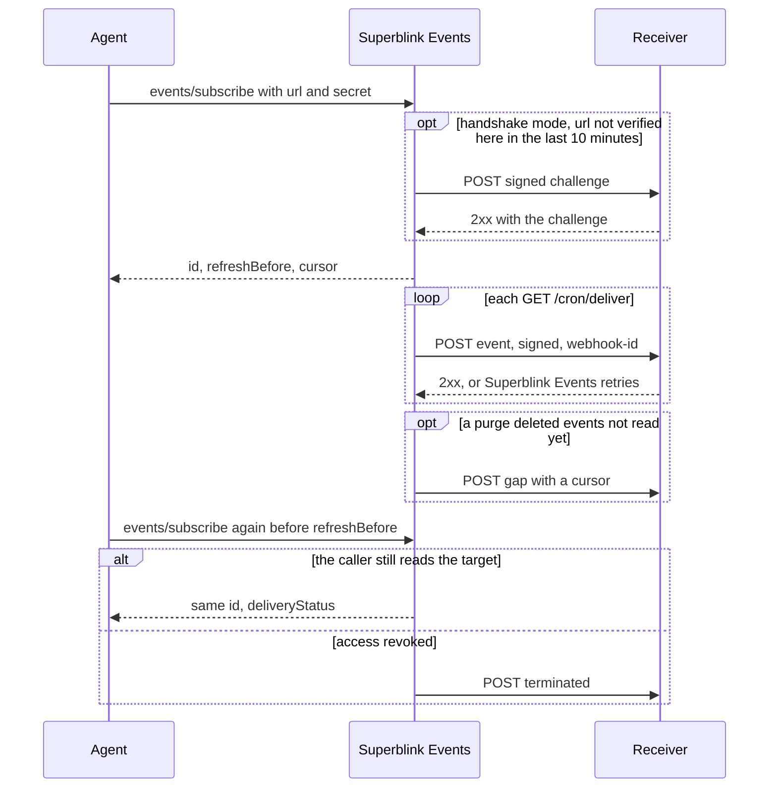

# Webhook subscriptions

An MCP client can call `events/subscribe` to have Superblink Events push matching events to a callback URL, as an alternative to waiting or polling. This page is the contract for whoever writes the receiver. It follows the draft MCP Events extension (SEP-3415) and [Standard Webhooks](https://www.standardwebhooks.com).



## Turn it on

Webhook mode is off until the operator sets `FAUCET_WEBHOOK_KEY` (`openssl rand -base64 32`; it seals subscriber secrets at rest) and chooses how Superblink Events checks callback URLs:

- **`allowlist`** (default): set `FAUCET_WEBHOOK_ALLOWED_ORIGINS` to the `https://host[:port]` origins that may receive events. Superblink Events makes no request to a callback URL until it has an event to send.
- **`handshake`**: set `FAUCET_WEBHOOK_CALLBACK_VERIFICATION=handshake` and leave the allowlist unset. A subscribe or a renewal makes Superblink Events send a signed challenge, which the endpoint must echo back, unless the same Superblink Events instance verified that login and URL in the last 10 minutes (see [Handshake](#handshake)).

While webhook mode is off, `events/list` offers `poll` only, `events/subscribe` and `events/unsubscribe` answer `Unsupported`, and `/cron/deliver` answers 503.

Keep `FAUCET_WEBHOOK_KEY` stable. Rows sealed under another key can't be read. Their deliveries end with `secret_unreadable` and the subscription is deleted until its subscriber renews.

## Subscribe

`events/subscribe` takes `name` (an [event name](events.md)), `arguments` (a [target](events.md#targets), which is `repo`, or for a service `owner` or `all` with an optional `repos`, optionally `sha` and `pr`, and for a family `actions` and the field filters it offers), `delivery` (`url` and `secret`) and optionally `cursor`, `maxAgeMs` and `ttlMs`. The HTTP request must carry an `Mcp-Name` header with the event name (see [the header rule](events.md#the-mcp-name-header)).

- The caller must be able to read the target: a person the repository, a service a grant that covers it. Superblink Events checks again on every renewal and at no other time, so a subscription whose caller lost access ends at its next renewal.
- `delivery.secret` is `whsec_` followed by base64 of 24 to 64 random bytes. The client makes it. Superblink Events never returns or logs it.
- `delivery.url` must be `https` with a public host, and it must pass the server's callback check.
- A subscription is the tuple (login, URL, event name, arguments). Arguments that differ only in key order, in the order or repeats of the values of `actions` or a field filter, or in the order, repeats or case of `repos`, are the same, and a family with `actions` and the same family without them are two subscriptions. Subscribing again with the same tuple renews it: same `id`, new expiry, and the secret is replaced (see [Secret rotation](#secret-rotation)).
- A subscription lives for `ttlMs`, clamped to between 30 seconds and 10 minutes (default 10 minutes). Renew before `refreshBefore`.
- A login can hold 100 live subscriptions. The next subscribe gets `ResourceExhausted` with `data.limit` `subscriptions`.

A renewal keeps the subscription's read position and ignores any `cursor` it carries. A subscribe after the subscription lapsed (it expired or was unsubscribed) starts after the `cursor` you send, read among the events of the target (see [cursors](events.md#cursors)): one above the target's newest event starts at the newest, and a `v1.` cursor starts there too, with `truncated: true`. A renewal also reports `deliveryStatus`: `lastDeliveryAt`, `lastError` and `failedSince`. `lastError`, and the `data.reason` of a `CallbackEndpointError`, take these values:

<!-- BEGIN generated:callback-reasons -->
| Value | In lastError | In data.reason | Meaning |
| --- | --- | --- | --- |
| `connection_refused` | yes | yes | The connection failed: the port refused it, the name did not resolve, or the address is not public. |
| `timeout` | yes | yes | No answer within 5 seconds. |
| `tls_error` | yes | yes | The TLS handshake or the certificate check failed. |
| `http_4xx` | yes | yes | A 4xx answer. For a delivery, also any other answer that is not 2xx, 5xx, `410` or `413`, such as a redirect. |
| `http_5xx` | yes | yes | A 5xx answer. For a delivery, also a response that declares a body over 64 KiB or has headers over 16 KiB. A delivery closes the body unread, so only a declared length counts. |
| `challenge_failed` | no | yes | The callback URL's origin is not on the allowlist, or the handshake got no 2xx answer of at most 1 KiB that echoes the challenge. |
<!-- END generated:callback-reasons -->

`events/unsubscribe` takes `name`, `arguments` (read as `events/subscribe` reads them) and `delivery.url`, and deletes the caller's own live subscription.

## Latency

Superblink Events sends webhooks only when `GET /cron/deliver` runs. With Vercel Cron that is once a minute, so **an event can wait up to a minute** before it is sent. A host that needs seconds can call `Service.DeliverDue` in its own loop.

## The request

```http
POST <delivery.url>
Content-Type: application/json
X-MCP-Subscription-Id: <subscription id>
webhook-id: msg_...
webhook-timestamp: <unix seconds>
webhook-signature: v1,<base64 HMAC-SHA256>

{"eventId": "msg_...", "name": "ci.run_completed", "timestamp": "...", "data": {...}, "cursor": "v2.123"}
```

- The signature is the Standard Webhooks HMAC over `<webhook-id>.<webhook-timestamp>.<body>`, keyed with the subscriber's secret. Verify it with any Standard Webhooks library.
- `name` is the subscribed name, and `name` and `data` match what `events/poll` of that name returns. `timestamp` is when Superblink Events received the event.
- `webhook-id` (and `eventId`, which equals it) is stable for one event to one subscription, across every retry and replay, while `FAUCET_WEBHOOK_KEY` stays the same: it is an HMAC under that key. **Deduplicate on it.** After a key change, a replay of an event that the receiver already has arrives with a new ID, once (see [deploy.md](deploy.md#rotating-faucet_webhook_key)). It differs from the GitHub delivery ID that `events/poll` reports.
- `cursor` is a safe watermark: every event of the subscription at or below it has been delivered or given up. It is a place among the events of the subscription's target, as an `events/poll` cursor is (see [cursors](events.md#cursors)), so other repositories' events never move it. Persist it, and pass it to `events/subscribe` if the subscription lapses. When the lowest unsent event was purged, the watermark lies below the target's purge mark, so a resume from it reports the loss.
- For a [raw name](events.md#raw-events), `data` is GitHub's payload, or the `fields` of it that the subscription named, and the `cursor` has the form `r1.<n>`. Superblink Events keeps no raw event for a subscription that does not exist, so a subscribe after a lapse answers `truncated: true` when it carries a cursor, and delivery starts with the next event.
- The request carries no `Authorization` header and no cookies. Nothing the endpoint sends back reaches Superblink Events' replies, logs or tables.

## Retries and outcomes

Any `2xx` answer ends the delivery. `410 Gone` and `413` end that delivery but not the subscription. Anything else, including a redirect (never followed), a refused connection, a TLS error or a 5 second timeout, is retried after 15 seconds, 1, 3 and 6 minutes: at most 5 attempts within 15 minutes.

Delivery is **at least once**. An attempt whose result Superblink Events could not record is sent again with the same `webhook-id`.

A delivery that a run takes and that doesn't succeed ends with one of these reasons, which `/cron/deliver` counts in `gave_up` and logs:

<!-- BEGIN generated:give-up-reasons -->
| Reason | Meaning |
| --- | --- |
| `endpoint_gone` | The endpoint answered `410 Gone`. This ends the delivery, not the subscription. |
| `endpoint_payload_too_large` | The endpoint answered `413`. This ends the delivery, not the subscription. |
| `event_too_large` | The body would be over 256 KiB, so Superblink Events never sent it. A raw subscription gets a gap. |
| `event_malformed` | Superblink Events could not build a body from the stored event. A raw subscription gets a gap. |
| `attempts_exhausted` | All 5 attempts failed. |
| `window_expired` | The next attempt would come more than 15 minutes after the event was queued. |
| `event_purged` | A retention purge deleted the event before the delivery ended, or, for a raw event, a purge dropped its payload. A raw subscription then gets a gap. |
| `repo_mismatch` | The event is outside the target that the subscription is granted now: another repository, or a repository of another owner. |
| `secret_unreadable` | The subscriber's sealed secret does not open, as after a change of `FAUCET_WEBHOOK_KEY`. The subscription is deleted too, until its subscriber renews. |
| `subscription_expired` | The subscription expired before the delivery ended. A raw delivery also ends so when its subscription was unsubscribed, or deleted after a renewal found access revoked. |
| `arguments_undecodable` | The subscription's stored arguments do not decode, or hold a list longer than an argument may now be, so Superblink Events deleted the subscription with its deliveries. |
<!-- END generated:give-up-reasons -->

A delivery can also end with its subscription and no reason: `events/unsubscribe` and a renewal that finds access revoked delete the subscription with the deliveries it still holds, and `/cron/purge` counts the deliveries of the expired subscriptions that it deletes in `ended_deliveries`.

A subscription that holds 100 unsent deliveries reads no new events until some of them end.

Superblink Events checks access only when the subscriber renews, so it sees revoked access **only at a renewal**. A subscription that is never renewed simply expires.

## Control messages

Superblink Events also sends two bodies with a top-level `type` and no `eventId` or `data`. They carry the same headers and signature. Each send gets a fresh `webhook-id` and is attempted once.

- `{"type":"gap","cursor":"v2.<n>"}`: a retention purge deleted events that the subscription hadn't read yet. The `cursor` is the highest place among the target's events that a purge deleted, so every event of the target that still exists lies above it. The check ignores the `sha`, `pr`, `repos` and field filter arguments, so a filtered subscription can get a gap for an event that its filter would have dropped. Treat it like `truncated: true` and persist the `cursor`. A gap can arrive more than once, so deduplicate gaps by `cursor` and keep the highest. A raw subscription gets a gap, with a cursor `r1.<n>`, for the events that arrived while it held 100 unsent deliveries, for an event whose payload, or the `fields` of it, or the body that carries them, is over 256 KiB, and for an event whose payload a purge dropped before its delivery ended.
- `{"type":"terminated","error":{"code":-32024,"message":"Forbidden","data":{"reason":"Access revoked"}}}`: a renewal found that the caller can no longer read the target, so the subscription was deleted. Delivery is at most once.

## Secret rotation

To rotate, call `events/subscribe` again with a new `delivery.secret`. For a grace window of up to 10 minutes (never longer than the subscription's TTL), Superblink Events signs with both secrets: `webhook-signature` holds `v1,<new> v1,<old>`, so a receiver that knows either one still verifies. Superblink Events keeps one previous secret, so a second rotation inside the window drops the first one.

Give your receiver the new secret before you rotate: a handshake that the rotating call triggers is signed with the new secret only.

## Handshake

In `handshake` mode, an `events/subscribe`, a renewal included, makes Superblink Events send one signed `POST` before the call returns, unless the same Superblink Events instance verified that login and URL in the last 10 minutes:

```json
{"type": "verification", "challenge": "<nonce>"}
```

The endpoint must verify the signature and answer `2xx` within 5 seconds, with `{"challenge": "<nonce>"}`. Any other answer fails the subscribe with `CallbackEndpointError` and stores nothing. Each instance remembers a success for that login and URL for 10 minutes, in its memory. A renewal that reaches another instance, or one that started since, sends the challenge again, so on many short-lived instances, as on Vercel, expect a handshake on most renewals.

Each instance limits handshakes with two token buckets. Each login has one per destination: 5 at once, then one every 12 seconds. Each destination has one for all logins: 60 at once, then one a second. An endpoint that answers correctly gives the tokens back. The buckets are per instance, so N instances allow N times as many. A call over a limit gets `ResourceExhausted` with `data.limit` `callbackVerifications` and stores nothing. If a public endpoint can front an internal service, prefer `allowlist` mode. See [security.md](security.md#callback-urls) for how Superblink Events guards callback URLs.
