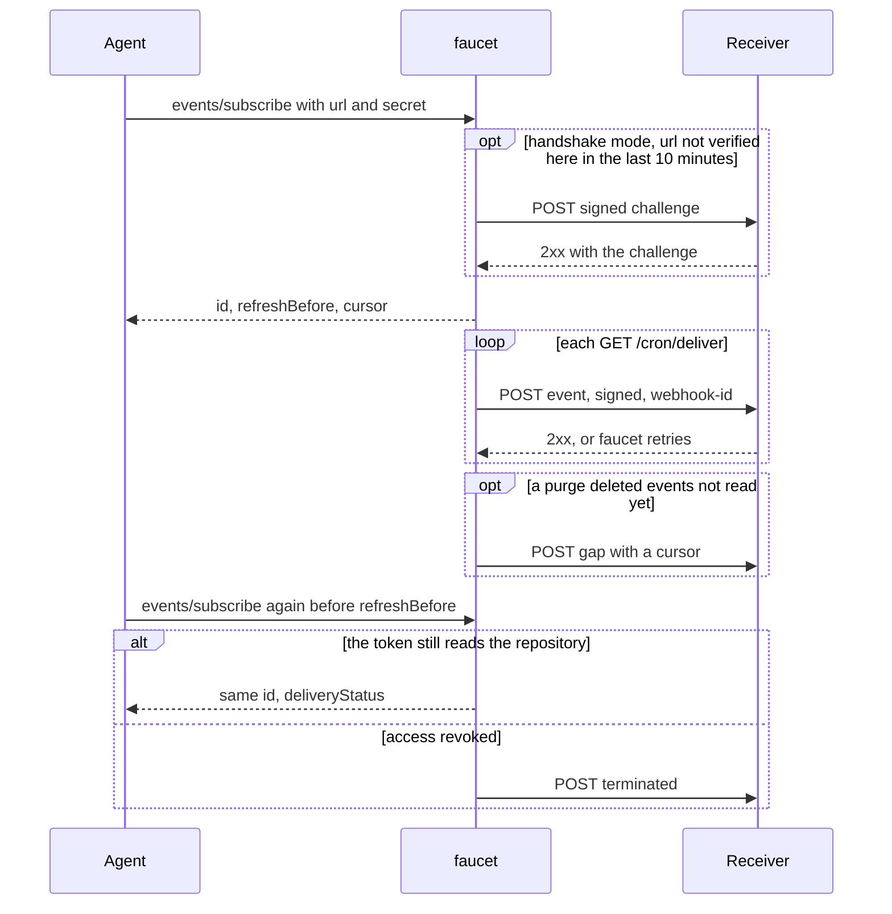

# Webhook subscriptions

An MCP client can call `events/subscribe` to have faucet push matching events to a callback URL, as an alternative to waiting or polling. This page is the contract for whoever writes the receiver. It follows the draft MCP Events extension (SEP-3415) and [Standard Webhooks](https://www.standardwebhooks.com).



## Turn it on

Webhook mode is off until the operator sets `FAUCET_WEBHOOK_KEY` (`openssl rand -base64 32`; it seals subscriber secrets at rest) and chooses how faucet checks callback URLs:

- **`allowlist`** (default): set `FAUCET_WEBHOOK_ALLOWED_ORIGINS` to the `https://host[:port]` origins that may receive events. Faucet makes no request to a callback URL until it has an event to send.
- **`handshake`**: set `FAUCET_WEBHOOK_CALLBACK_VERIFICATION=handshake` and leave the allowlist unset. A subscribe or a renewal makes faucet send a signed challenge, which the endpoint must echo back, unless the same faucet instance verified that login and URL in the last 10 minutes (see [Handshake](#handshake)).

While webhook mode is off, `events/list` offers `poll` only, `events/subscribe` and `events/unsubscribe` answer `Unsupported`, and `/cron/deliver` answers 503.

Keep `FAUCET_WEBHOOK_KEY` stable. Rows sealed under another key can't be read. Their deliveries end with `secret_unreadable` and the subscription is deleted until its subscriber renews.

## Subscribe

`events/subscribe` takes `name` (an [event name](events.md)), `arguments` (`repo`, optionally `sha` and `pr`, and for a family `actions` and the field filters it offers), `delivery` (`url` and `secret`) and optionally `cursor`, `maxAgeMs` and `ttlMs`. The HTTP request must carry an `Mcp-Name` header with the event name (see [the header rule](events.md#the-mcp-name-header)).

- The token must be able to read the repository. Faucet checks again on every renewal, because it stores no token.
- `delivery.secret` is `whsec_` followed by base64 of 24 to 64 random bytes. The client makes it. Faucet never returns or logs it.
- `delivery.url` must be `https` with a public host, and it must pass the server's callback check.
- A subscription is the tuple (login, URL, event name, arguments). Arguments that differ only in key order, or in the order or repeats of the values of `actions` or a field filter, are the same, and a family with `actions` and the same family without them are two subscriptions. Subscribing again with the same tuple renews it: same `id`, new expiry, and the secret is replaced (see [Secret rotation](#secret-rotation)).
- A subscription lives for `ttlMs`, clamped to between 30 seconds and 10 minutes (default 10 minutes). Renew before `refreshBefore`.
- A login can hold 100 live subscriptions. The next subscribe gets `ResourceExhausted` with `data.limit` `subscriptions`.

A renewal keeps the subscription's read position and ignores any `cursor` it carries. A subscribe after the subscription lapsed (it expired or was unsubscribed) starts after the `cursor` you send. A renewal also reports `deliveryStatus`: `lastDeliveryAt`, `lastError` and `failedSince`. `lastError`, and the `data.reason` of a `CallbackEndpointError`, take these values:

<!-- BEGIN generated:callback-reasons -->
<!-- END generated:callback-reasons -->

`events/unsubscribe` takes `name`, `arguments` (read as `events/subscribe` reads them) and `delivery.url`, and deletes the caller's own live subscription.

## Latency

Faucet sends webhooks only when `GET /cron/deliver` runs. With Vercel Cron that is once a minute, so **an event can wait up to a minute** before it is sent. A host that needs seconds can call `Service.DeliverDue` in its own loop.

## The request

```http
POST <delivery.url>
Content-Type: application/json
X-MCP-Subscription-Id: <subscription id>
webhook-id: msg_...
webhook-timestamp: <unix seconds>
webhook-signature: v1,<base64 HMAC-SHA256>

{"eventId": "msg_...", "name": "ci.run_completed", "timestamp": "...", "data": {...}, "cursor": "v1.123"}
```

- The signature is the Standard Webhooks HMAC over `<webhook-id>.<webhook-timestamp>.<body>`, keyed with the subscriber's secret. Verify it with any Standard Webhooks library.
- `name` is the subscribed name, and `name` and `data` match what `events/poll` of that name returns. `timestamp` is when faucet received the event.
- `webhook-id` (and `eventId`, which equals it) is stable for one event to one subscription, across every retry and replay, while `FAUCET_WEBHOOK_KEY` stays the same: it is an HMAC under that key. **Deduplicate on it.** After a key change, a replay of an event that the receiver already has arrives with a new ID, once (see [deploy.md](deploy.md#rotating-faucet_webhook_key)). It differs from the GitHub delivery ID that `events/poll` reports.
- `cursor` is a safe watermark: every event of the subscription at or below it has been delivered or given up. Persist it, and pass it to `events/subscribe` if the subscription lapses.
- The request carries no `Authorization` header and no cookies. Nothing the endpoint sends back reaches faucet's replies, logs or tables.

## Retries and outcomes

Any `2xx` answer ends the delivery. `410 Gone` and `413` end that delivery but not the subscription. Anything else, including a redirect (never followed), a refused connection, a TLS error or a 5 second timeout, is retried after 15 seconds, 1, 3 and 6 minutes: at most 5 attempts within 15 minutes.

Delivery is **at least once**. An attempt whose result faucet could not record is sent again with the same `webhook-id`.

A delivery that doesn't succeed ends with one of these reasons, which `/cron/deliver` counts in `gave_up` and logs:

<!-- BEGIN generated:give-up-reasons -->
<!-- END generated:give-up-reasons -->

A subscription that holds 100 unsent deliveries reads no new events until some of them end.

Faucet keeps no subscriber's token, so it only sees revoked access **when the subscriber renews**. A subscription that is never renewed simply expires.

## Control messages

Faucet also sends two bodies with a top-level `type` and no `eventId` or `data`. They carry the same headers and signature. Each send gets a fresh `webhook-id` and is attempted once.

- `{"type":"gap","cursor":"v1.<n>"}`: a retention purge deleted events that the subscription hadn't read yet. The check ignores the `sha`, `pr` and field filter arguments, so a filtered subscription can get a gap for an event that its filter would have dropped. Treat it like `truncated: true` and persist the `cursor`. A gap can arrive more than once, so deduplicate gaps by `cursor` and keep the highest.
- `{"type":"terminated","error":{"code":-32024,"message":"Forbidden","data":{"reason":"Access revoked"}}}`: a renewal found that the token can no longer read the repository, so the subscription was deleted. Delivery is at most once.

## Secret rotation

To rotate, call `events/subscribe` again with a new `delivery.secret`. For a grace window of up to 10 minutes (never longer than the subscription's TTL), faucet signs with both secrets: `webhook-signature` holds `v1,<new> v1,<old>`, so a receiver that knows either one still verifies. Faucet keeps one previous secret, so a second rotation inside the window drops the first one.

Give your receiver the new secret before you rotate: a handshake that the rotating call triggers is signed with the new secret only.

## Handshake

In `handshake` mode, an `events/subscribe`, a renewal included, makes faucet send one signed `POST` before the call returns, unless the same faucet instance verified that login and URL in the last 10 minutes:

```json
{"type": "verification", "challenge": "<nonce>"}
```

The endpoint must verify the signature and answer `2xx` within 5 seconds, with `{"challenge": "<nonce>"}`. Any other answer fails the subscribe with `CallbackEndpointError` and stores nothing. Each instance remembers a success for that login and URL for 10 minutes, in its memory. A renewal that reaches another instance, or one that started since, sends the challenge again, so on many short-lived instances, as on Vercel, expect a handshake on most renewals.

Each instance limits handshakes with two token buckets. Each login has one per destination: 5 at once, then one every 12 seconds. Each destination has one for all logins: 60 at once, then one a second. An endpoint that answers correctly gives the tokens back. The buckets are per instance, so N instances allow N times as many. A call over a limit gets `ResourceExhausted` with `data.limit` `callbackVerifications` and stores nothing. If a public endpoint can front an internal service, prefer `allowlist` mode. See [security.md](security.md#callback-urls) for how faucet guards callback URLs.
